# Admin console tour

The web admin console is the day-to-day surface for accounts, policies, plugin
settings, storage, and jobs. It is a normal part of the Girder web client; there
is no separate administration application to install.

Sign in as a user with the site-admin flag, then choose **Admin console** in the
left navigation. You can also open it directly:

```text
http://localhost:8080/#admin
```

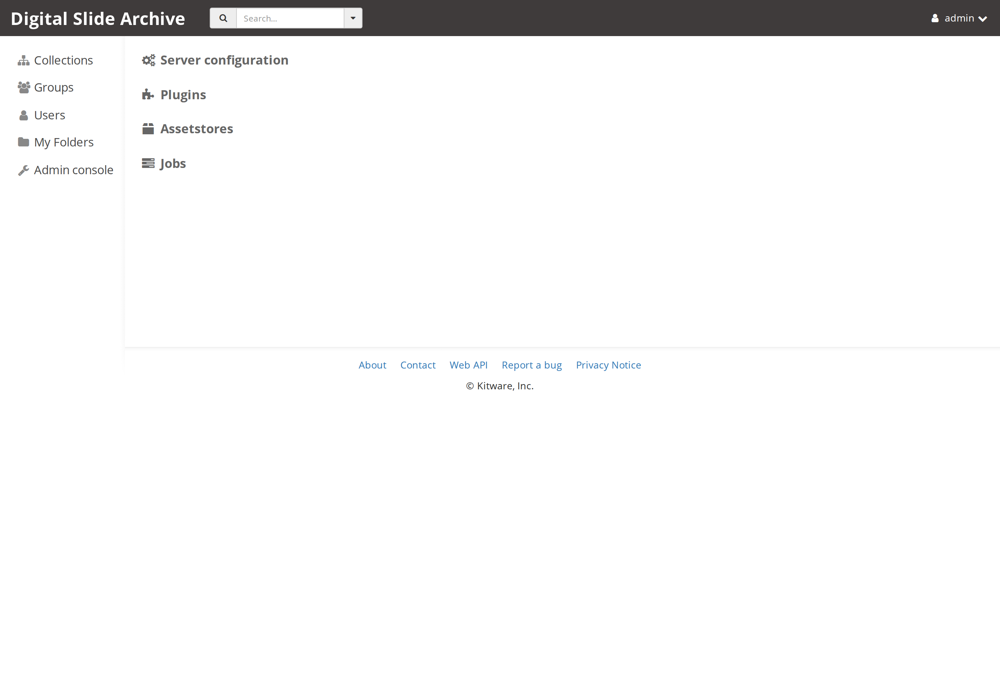

The console menu has four entries:

| Entry | What it opens |
| --- | --- |
| **Server configuration** | Instance branding, registration and collection policy, email, and advanced server settings |
| **Plugins** | The installed plugin list and each plugin's configuration page |
| **Assetstores** | Storage backends, their capacity, import actions, and creation forms |
| **Jobs** | Server-wide job history, job status, and per-job log output |

**Users**, **Groups**, and **Collections** are not inside the four-entry menu.
They are top-level navigation items, shown to administrators in the left sidebar,
and are part of the operator's console even though they use the same pages that
ordinary users see with fewer permissions.

## Users

Open `http://localhost:8080/#users` or choose **Users** in the left navigation.

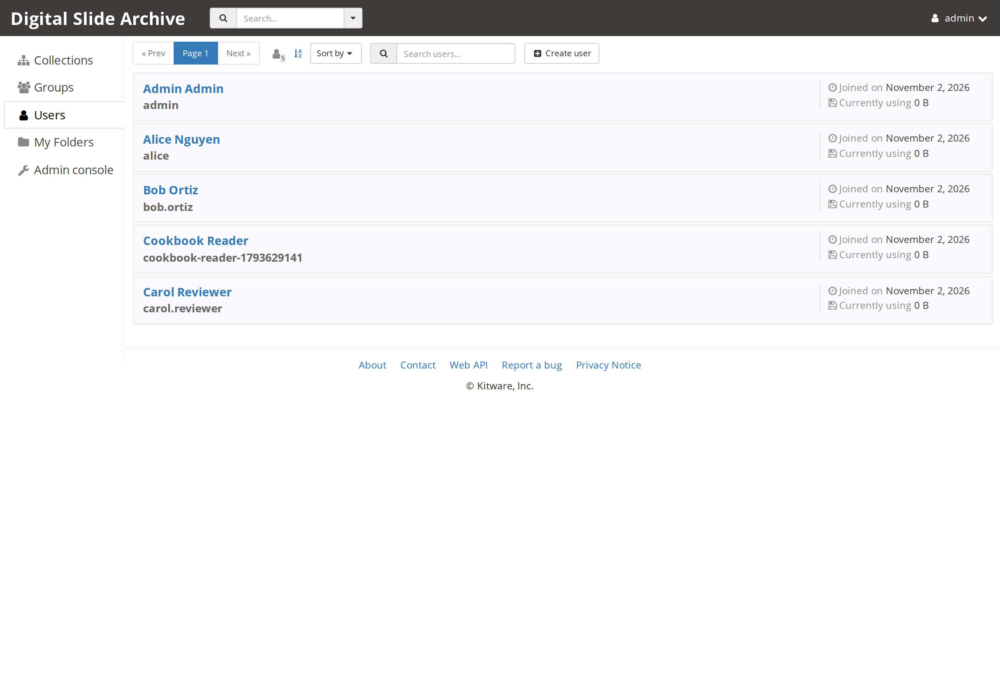

The list shows the display name, login, join date, and current storage use for
each account. The toolbar provides paging, user-count and sort controls, a user
search, and **Create user**.

Choose **Create user** to open the account form:

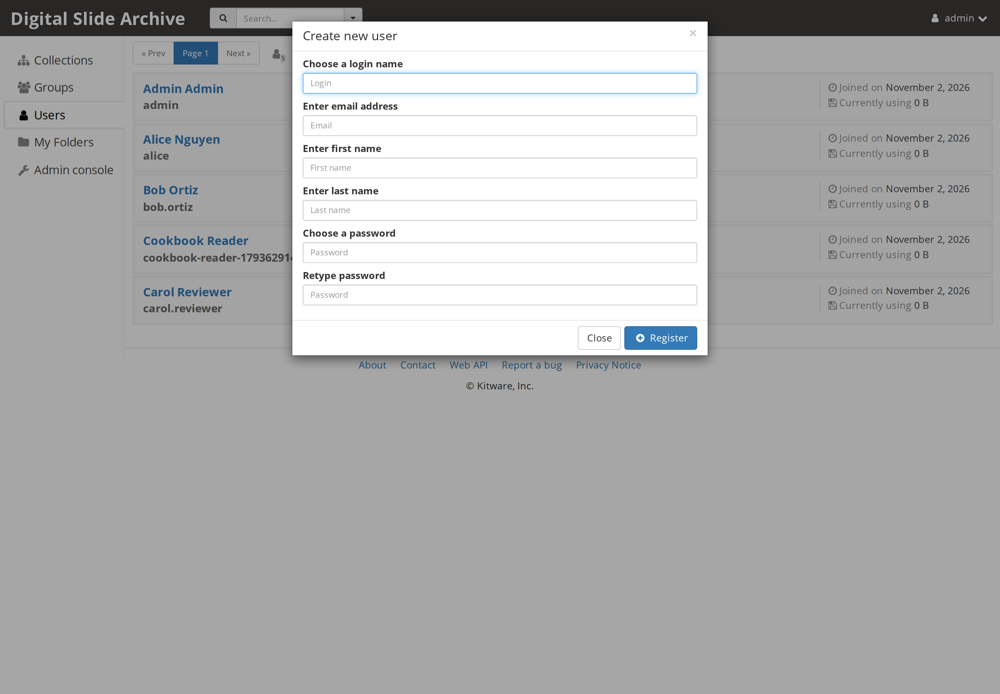

The form creates a normal, non-admin account. The fields are login, email, first
name, last name, and password (entered twice). The new user is created with the
default personal folders configured on the instance; the stock setting creates
**Private** and **Public** folders. Group membership and the site-admin flag are
not part of this form.

To edit an existing account, open the user and choose **Actions → Edit user**.
The profile page includes the **User is site admin** checkbox:

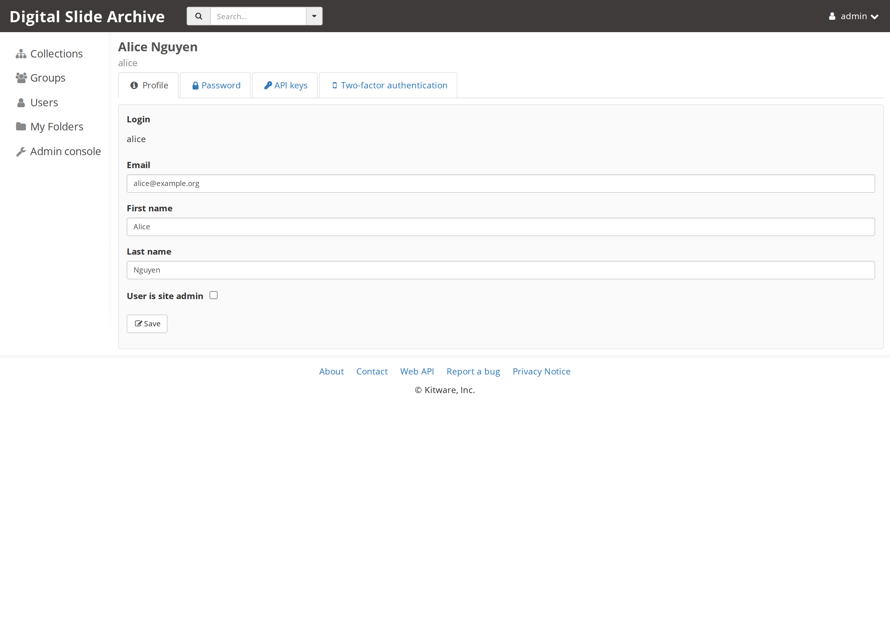

The **Actions** menu on a user page also contains **Disable account**,
**Quota and assetstore policies**, and **Delete user**. Disabling an account
blocks sign-in but keeps the account and its data; the menu then shows **Enable
account**. Deleting an account is destructive. See
[Users, groups, and roles for operators](users-and-roles.md) for the behavior and
the cautions.

## Groups

Open `http://localhost:8080/#groups` or choose **Groups** in the left navigation.

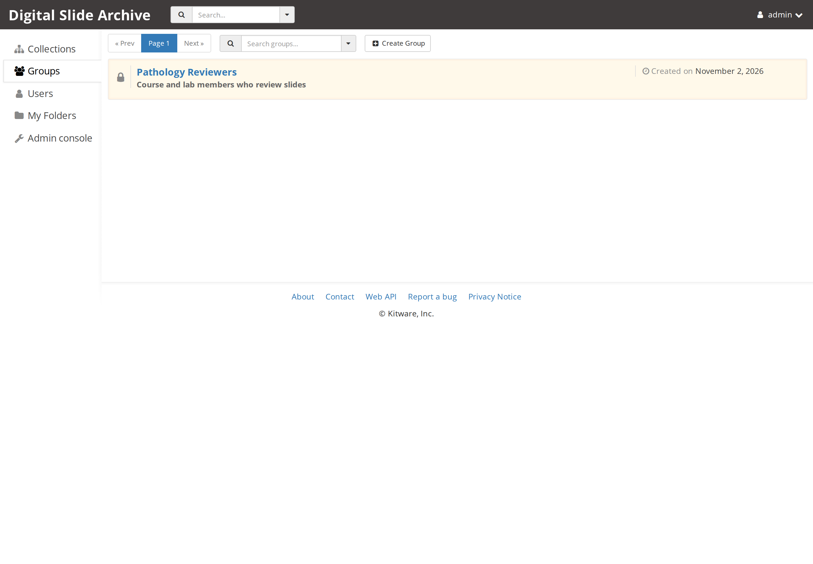

A group bundles users for sharing and for group-specific access. The list shows
the group name and creation date. Choose **Create Group** to create one.

Open a group to see its **Roles** tab, member list, and pending invitations:

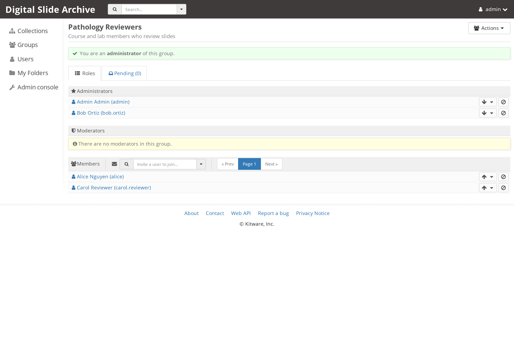

The roles are Girder's group roles, not site-wide roles:

- **Administrators** can manage group membership and the group itself.
- **Moderators** can add and remove members and edit the group.
- **Members** are ordinary members.

Group roles do not grant access to collections or folders by themselves. The
sharing model is covered in
[Permissions and access control](../user-guide/permissions.md); this page only
covers the operator's account and group management screens.

## Collections

Open `http://localhost:8080/#collections` or choose **Collections** in the left
navigation.

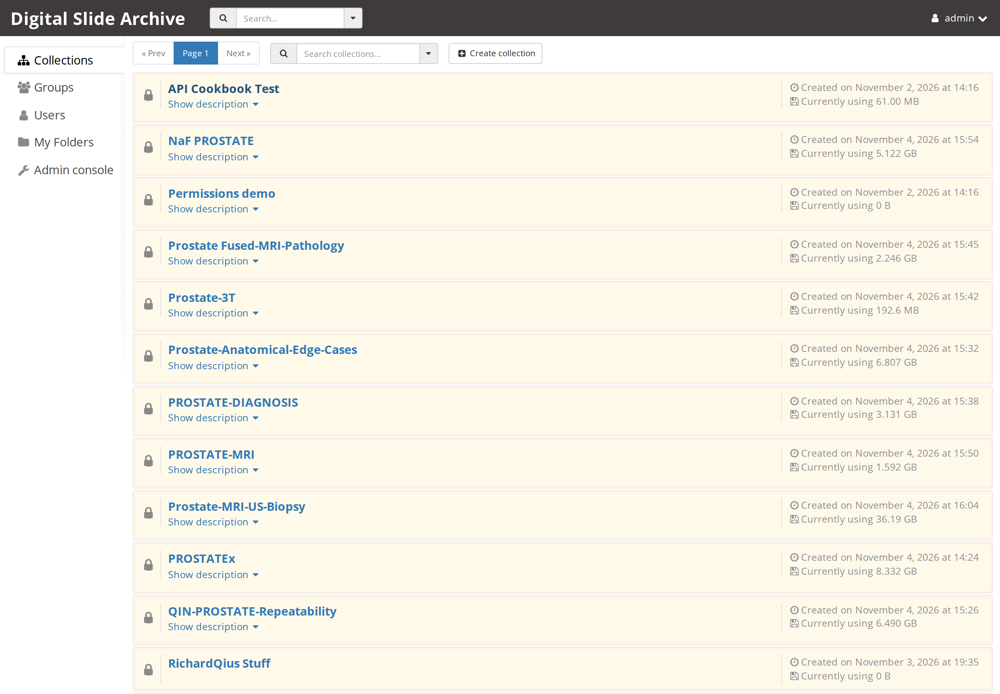

An administrator sees every collection on the instance, including private ones.
The page shows the collection name, creation date, and storage use, with
**Create collection** in the toolbar.

The stock instance allows only administrators to create collections. The
**Collection creation policy** in **Server configuration** can allow additional
users or groups; see [settings](settings.md#administrative-policy). Collections
are metadata containers, not storage locations. The files themselves live in an
assetstore, covered in [Assetstores and storage](assetstores-and-storage.md).

## Plugins

Open **Admin console → Plugins**, or `http://localhost:8080/#plugins`.

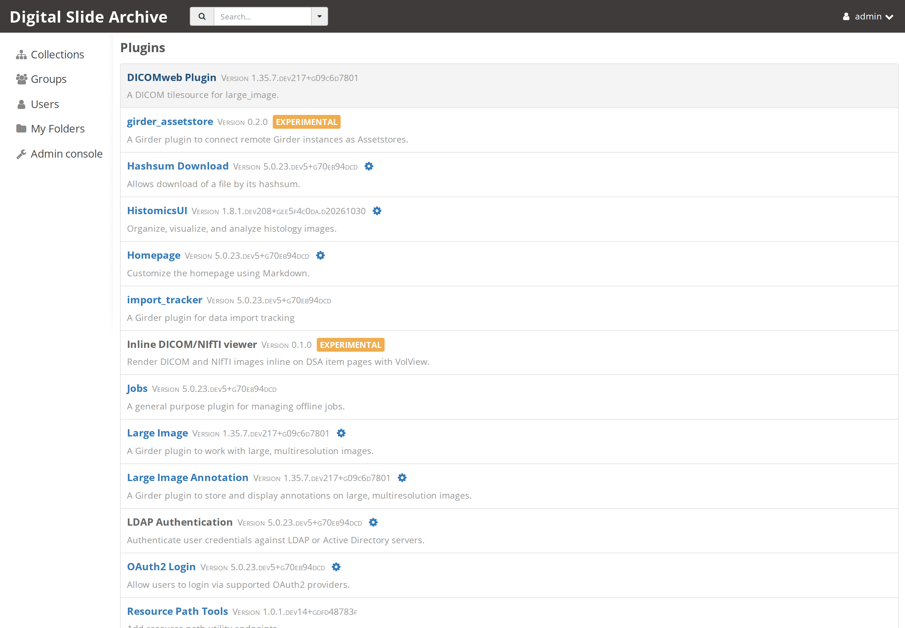

The page lists every loaded plugin with its version and description. The DSA
stack includes HistomicsUI, large_image, large_image annotation, Slicer CLI Web,
Worker, Homepage, Jobs, DICOMweb, import tracking, and several Girder plugins.
The version strings are the quickest way to confirm what is actually running
after an upgrade.

A plugin with settings shows a gear-shaped **Configure Plugin** link. The link
opens a full configuration page, not a dialog, at a URL such as
`http://localhost:8080/#plugins/large_image/config`.

### Large image

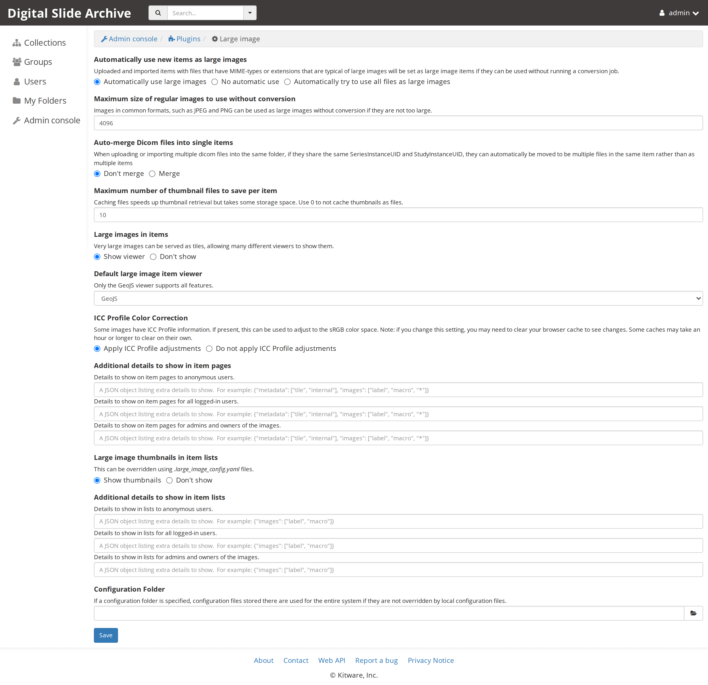

The page controls automatic large-image use, the maximum size of regular images
used without conversion, DICOM merging, thumbnail caching, the default viewer,
ICC color correction, extra metadata fields, and an optional configuration
folder. The default thumbnail cache is 10 thumbnail files per item; `0` disables
thumbnail file caching. These settings are read when thumbnails and viewers are
requested, so saving them does not require a restart.

### HistomicsUI

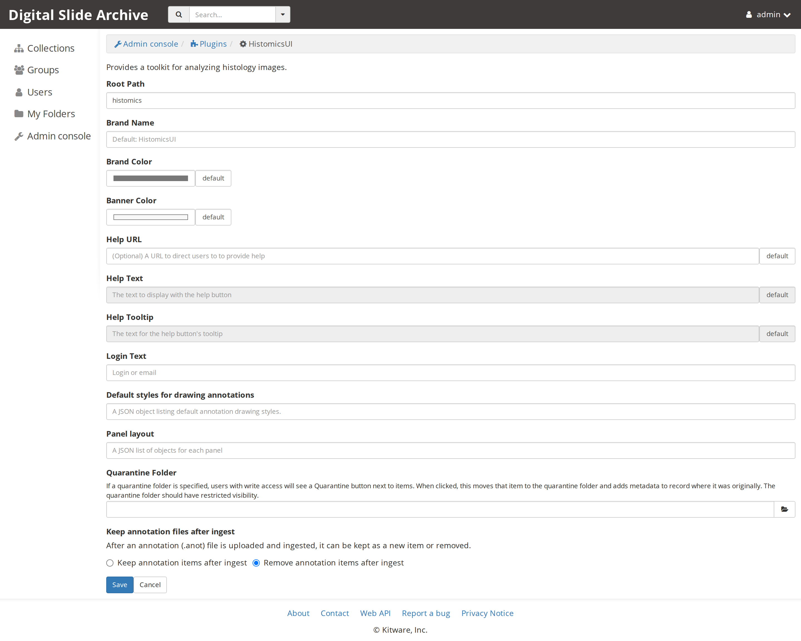

The page controls the HistomicsUI URL path, brand and banner colors, help text
and URL, login text, default annotation drawing styles, panel layout, a
quarantine folder, and whether annotation files and items are kept after ingest.

**Root Path** and **Alternate Root Path** are different from the display
settings: they are mounted when the plugin loads. Changing either requires a
Girder restart. The other values on this page are read at request time.

### Slicer CLI Web

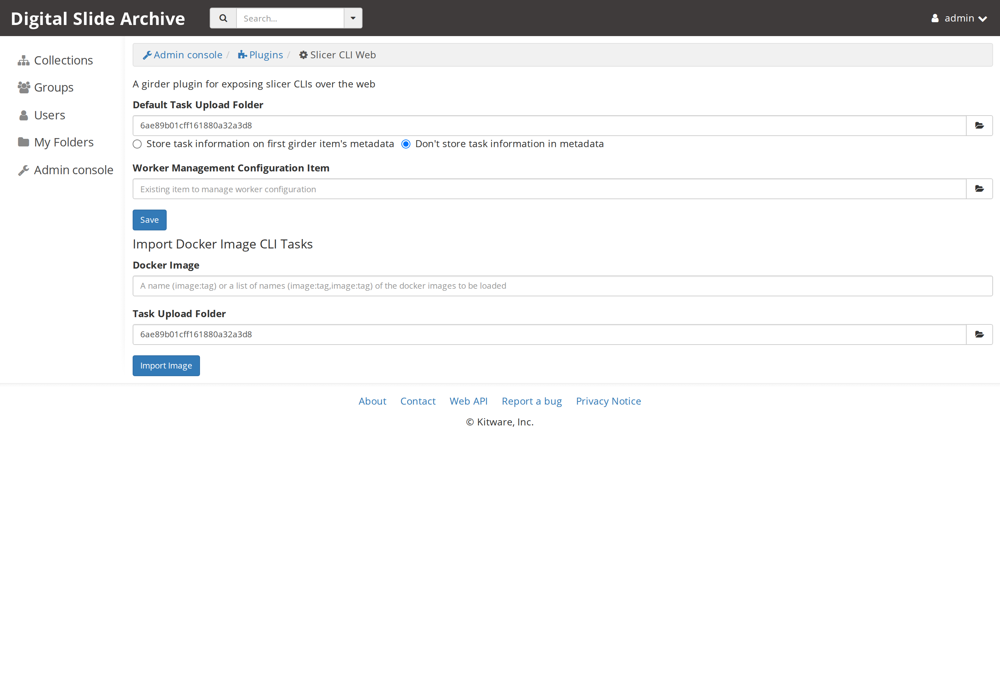

The page sets the default task upload folder, whether task information is stored
in the first item's metadata, an optional worker configuration item, and the
**Import Docker Image CLI Tasks** action. The task folder must be an existing
Girder folder, and the import action requires Docker access from the Girder
container.

### Worker

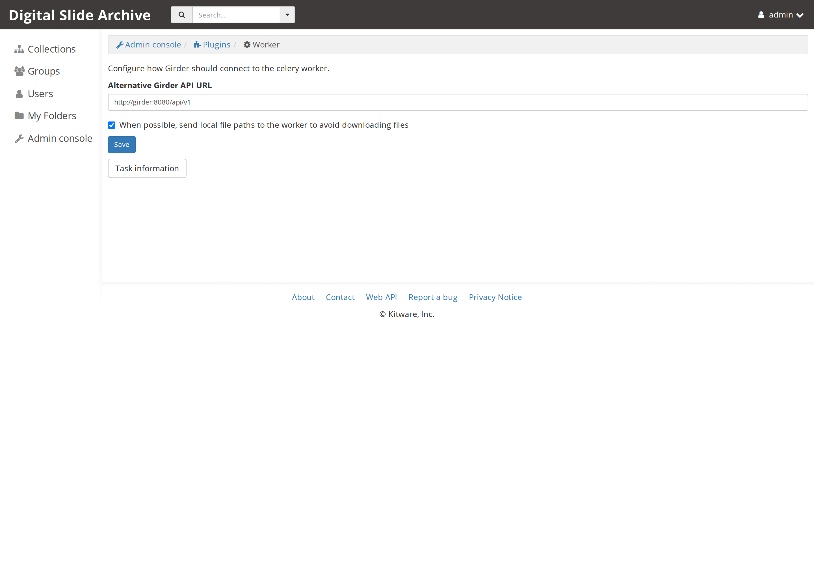

The page sets the **Alternative Girder API URL** and whether Girder sends local
file paths to the worker when possible. In the stock stack the API URL is
`http://girder:8080/api/v1` and direct paths are enabled, which lets jobs read
bind-mounted data without downloading it first. These values apply to new job
submissions.

The worker itself, the RabbitMQ broker URL, and the worker concurrency are
Compose environment variables, not settings on this page. See
[settings](settings.md#worker-and-rabbitmq).

## Server configuration

Open **Admin console → Server configuration**, or `http://localhost:8080/#settings`.

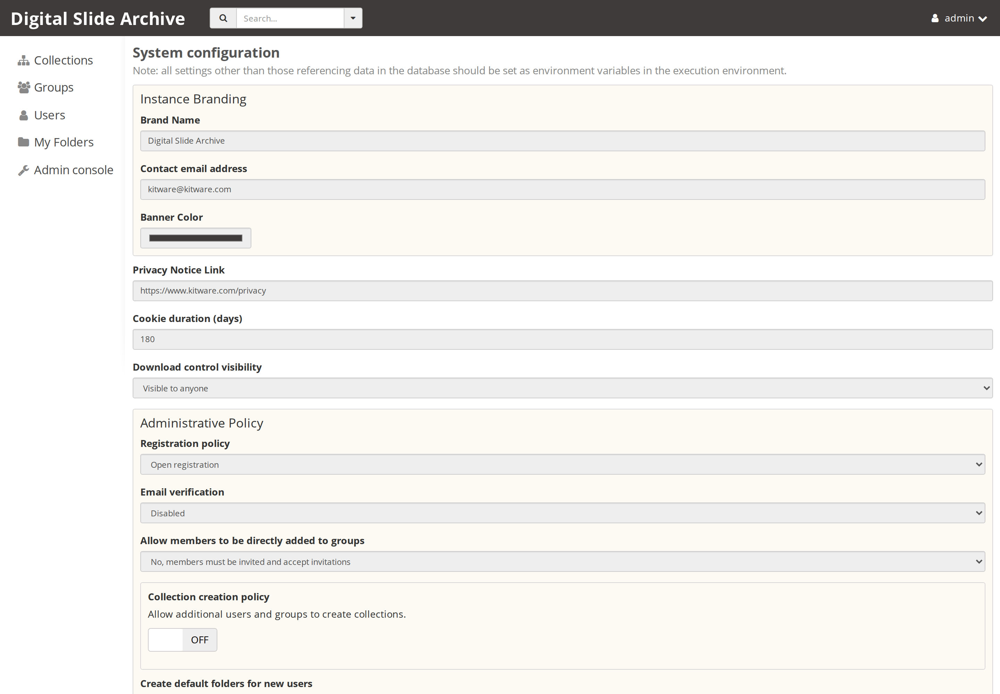

The page is organized into **Instance Branding**, **Administrative Policy**,
**Email Creation**, **Email Delivery**, and **Advanced Settings**. The main
operator settings are:

- Brand name, contact email, banner color, privacy notice link, cookie duration,
  and download-control visibility.
- Registration policy, email verification, whether members can be added directly
  to groups, the collection creation policy, and default folders for new users.
- API keys, password login, anonymous access, and the default email sender.
- SMTP host, port, encryption, username, and password.

The page itself carries the warning that settings not tied to database data
should be supplied as environment variables in the execution environment. In a
DSA Compose deployment, the practical rule is: use the console for values you
want to change at runtime, and use the Compose environment for values that
describe the deployment itself.

Expand **Advanced Settings** for the server root URL, upload minimum chunk size,
and CORS:

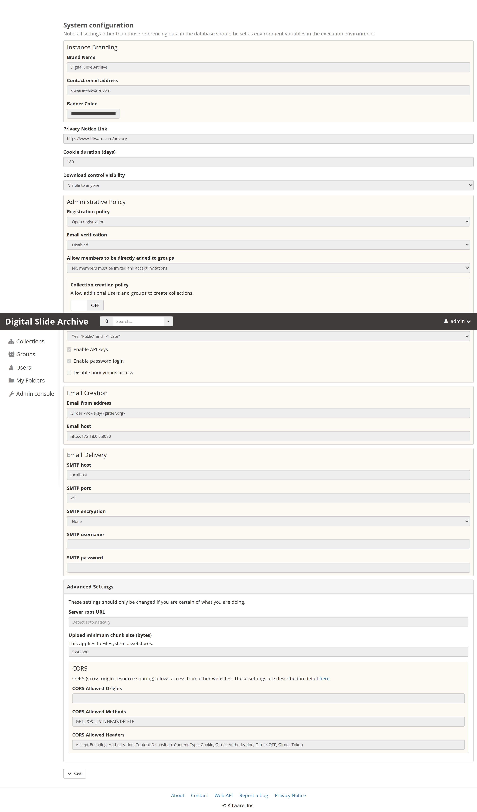

The meaning and restart behavior of each group is covered in
[Plugin and system settings that matter for DSA](settings.md).

## Assetstores

Open **Admin console → Assetstores**, or `http://localhost:8080/#assetstores`.

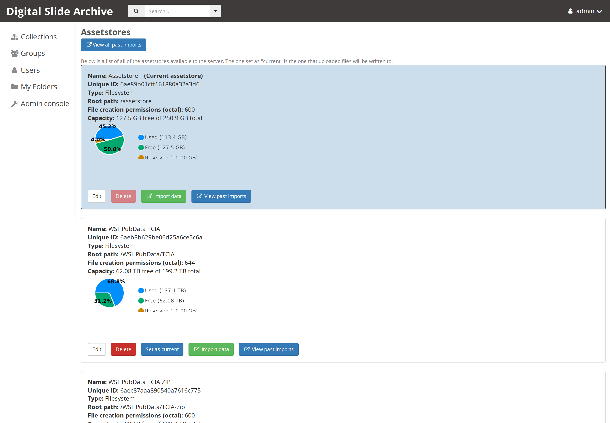

Each block shows the assetstore name, unique ID, type, root path, file creation
permissions, and, for local filesystems, capacity and free space. The current
assetstore is marked and receives new uploads. The actions are **Edit**,
**Delete**, **Set as current**, **Import data**, and **View past imports**.

The stock `devops/ver5` instance has one filesystem assetstore named
**Assetstore** with root `/assetstore`. The screenshot above is from a local
instance that also has two read-only filesystem assetstores for a public dataset;
those extra mounts are site-specific, not part of the stock Compose file.

Create a filesystem assetstore with **Create new Filesystem assetstore**:

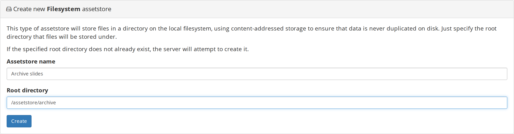

The form asks for a name and a root directory as seen **inside the Girder
container**. If the directory does not exist, Girder attempts to create it, so
the parent must be writable by the container user. The root path and permission
details are covered in [Assetstores and storage](assetstores-and-storage.md).

The page also offers **Amazon S3**, **Girder**, and **DICOMweb** assetstores.
The DICOMweb form asks for a server URL, optional QIDO and WADO prefixes, and an
optional authentication type:

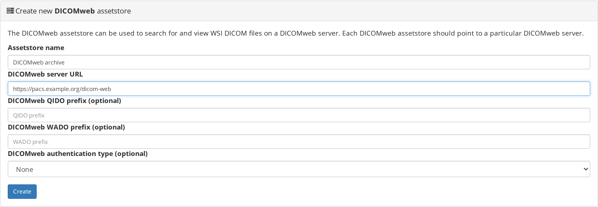

A DICOMweb assetstore is a proxy to a remote DICOMweb server, not a local copy of
the data. Backups and availability for that data remain the remote server's
responsibility.

## Jobs and job logs

Open **Admin console → Jobs**, or `http://localhost:8080/#jobs`.

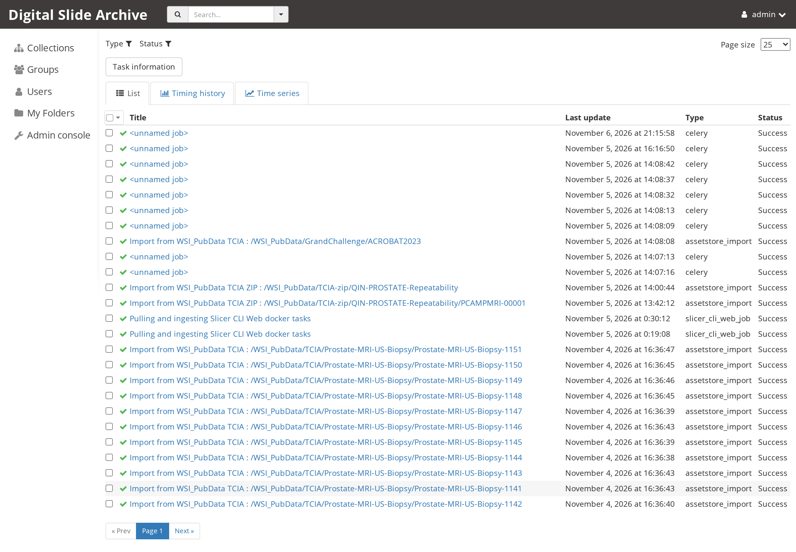

The list shows the job title, last update, type, and status. The toolbar filters
by page size, type, status, and task information, with list, timing-history, and
time-series views. The stock instance records `celery` analysis jobs,
`assetstore_import` jobs, and `slicer_cli_web_job` image-ingest jobs.

Choose a job to see its metadata, timeline, log output, and keyword arguments:

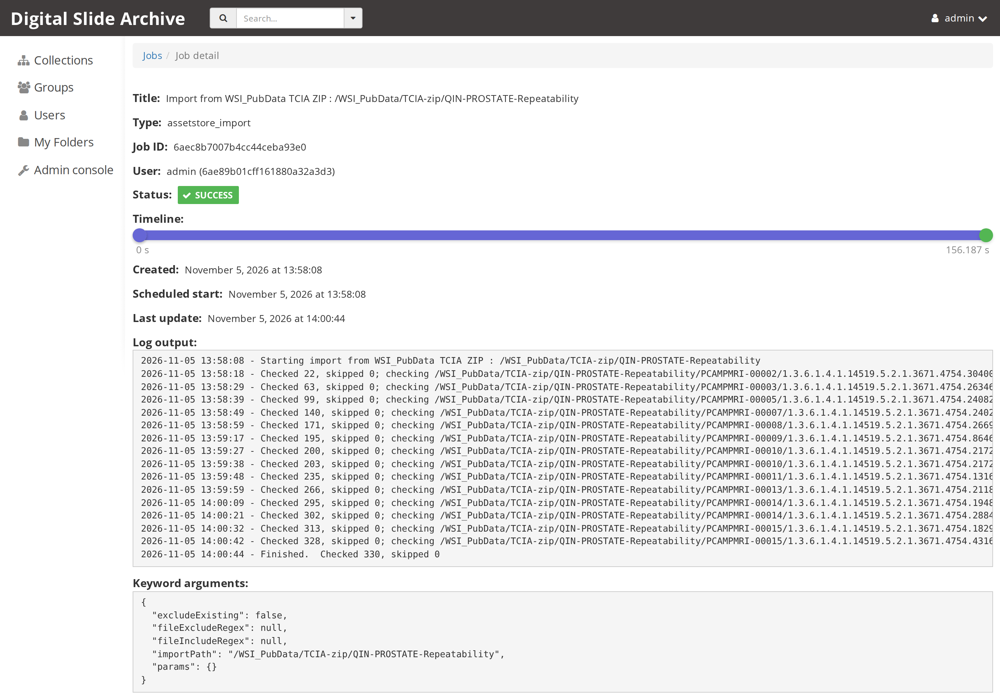

This is the first place to look when an analysis or import fails: the log output
belongs to the job and is kept with the job record. The **Jobs** page is not the
container log viewer. Raw Girder, worker, MongoDB, RabbitMQ, Redis, and logging
container output is written by the `logging` service into the `logs/` directory
and can also be read with `docker compose logs`. The
[troubleshooting guide](../troubleshooting.md) covers both paths.

## What the console does not do

- It does not enable or disable plugins. The Plugins page lists what the image
  loaded and configures plugins that expose settings; plugin packages come from
  the image and the provision/Compose setup.
- It does not change the published port, bind mounts, database address, broker
  URL, or worker concurrency. Those are Compose environment values.
- It does not copy files between assetstores. Use **Import data** for a
  filesystem assetstore or the file-import routes described in
  [Upload or import images](../tutorials/upload-images.md).

??? note "Source and version"

    Screens and behavior were checked on a live local DSA 5 instance on
    2026-11-13. The instance was started from the stock `devops/ver5` stack at
    commit `2e16b9a`; the extra `/WSI_PubData` assetstores visible in one
    screenshot are a local site mount and are not part of the stock Compose file.

    | Item | Value |
    | --- | --- |
    | DSA / Girder | `5.0.23.dev5+g70eb94dcd` |
    | HistomicsUI | `1.8.1.dev208+gee5f4c0da.d20261030` |
    | large_image | `1.35.7.dev217+g09c6d7801` |
    | Slicer CLI Web / Worker | `5.0.23.dev5+g70eb94dcd` |
    | Deployment files | `devops/ver5` at `2e16b9a` |
    | Web address | `http://localhost:8080` |
