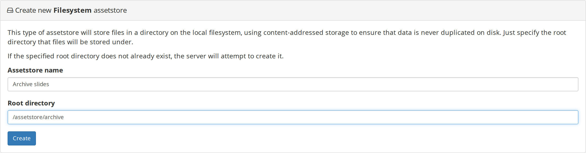
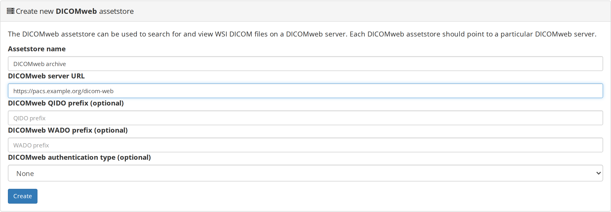

# Assetstores and storage

An assetstore is the storage backend that holds file contents. Girder keeps the
file records in MongoDB and writes the bytes to an assetstore. DSA can use more
than one assetstore at a time, and a file record remembers which assetstore it
belongs to. The generic storage model is documented in the upstream
[Girder documentation](https://girder.readthedocs.io/); this page covers the
DSA deployment, the kinds of assetstore DSA adds, and the operator procedures.

For an operator, three things matter:

1. Where the bytes physically live.
2. Which assetstore receives new uploads.
3. What has to be backed up together so the files and the database stay
   consistent.

## The assetstore is not the collection

A **collection** is a metadata container. An **item** is a metadata record.
A **file** belongs to an item and points at content in an assetstore. Deleting a
collection or item changes the database and may remove file records; it does not
mean the bytes were never written to the assetstore. Do not treat the collection
tree as a filesystem, and do not browse the assetstore directory to decide what
data exists.

## The stock `devops/ver5` layout

The stock Compose file bind-mounts three directories into the Girder container:

```yaml
services:
  girder:
    volumes:
      - ./assetstore:/assetstore
      - ./logs:/logs

  mongodb:
    volumes:
      - ./db:/data/db
```

The default assetstore is created by `provision.yaml`:

```yaml
assetstore:
  method: createFilesystemAssetstore
  name: Assetstore
  root: /assetstore
```

The result on the host is:

| Host path | Container path | Holds |
| --- | --- | --- |
| `devops/ver5/assetstore/` | `/assetstore` | File contents for the default filesystem assetstore |
| `devops/ver5/db/` | `/data/db` | MongoDB database files |
| `devops/ver5/logs/` | `/logs` | Container logs collected by the `logging` service |

`provision.py` creates the default assetstore only when no assetstore exists.
Stopping and starting the stack does not recreate or clear it, because the data
is on bind mounts.

### Content-addressed files

A filesystem assetstore stores files by their SHA-512 hash:

```text
assetstore/ad/b3/adb3a84e9693f19e76aa28de6f0d21ea61e960838bc6e87454d275ebc85c9165a20df6365f5f677b85bd28980d6225981fc35f36e5a329076679e6cdb1cbb2ea
assetstore/f5/b0/f5b05381306c1ac6d1b676e2b6e96cd8509cd8c5e782e80004006c9369eede85003e1298e868349aab362aafca3d4958b0d5bc4a4c1398ecc127e21a66f2eab3
```

The first two hex characters are the first directory level, the next two are the
second, and the filename is the SHA-512 of the content. Identical content is
stored once. The layout is an implementation detail: do not rename, move, or
edit files in an assetstore by hand. The database record contains the path that
matches this layout.

A filesystem assetstore may also contain a `temp/` directory for in-progress
uploads and `.deleteLock` marker files. Leave them alone unless you are
following a documented recovery procedure.

## Register a new filesystem assetstore

1. Sign in as a site admin.
2. Open **Admin console → Assetstores**.
3. Choose **Create new Filesystem assetstore**.
4. Enter a name and a root directory as seen inside the Girder container.
5. Choose **Create**.



For the stock stack, a root under `/assetstore` appears on the host under
`devops/ver5/assetstore/`. For example, a container root of
`/assetstore/archive` appears at `devops/ver5/assetstore/archive`. If the
directory does not exist, Girder attempts to create it; the parent directory must
be writable by the container user.

After creation, the new assetstore appears in the list. It is **not** the current
assetstore unless you choose **Set as current**. Uploads continue to go to the
current assetstore. Existing file records keep pointing at the assetstore where
they were written.

### What "current" means

The current assetstore receives new uploads. Changing it is a live routing
decision, not a migration:

- Files already stored in the old assetstore remain there.
- New files go to the new assetstore.
- Both assetstores must stay available for users to read their existing files.
- Back up every registered filesystem assetstore, not just the current one.

### Registering existing files

Creating an assetstore does not import the directory's contents into Girder.
If the directory already contains files, the assetstore record only makes the
root available. Use the assetstore's **Import data** action to import files into
a collection or folder. The import flow, including recursive import and
`leafFoldersAsItems`, is covered in
[Upload or import images](../tutorials/upload-images.md).

### Deleting an assetstore

Deleting an assetstore removes its registration from the database. It does not
delete the files from disk. This is useful for cleaning up a mistaken
registration, but it is not a data-erasure operation. Remove the directory
yourself only after you are certain that no file record still references it.

## Path and permission pitfalls

### The root path is a container path

Use the path inside the Girder container, not the host path. A root of
`/home/me/slides` only works if that path is also mounted into the container. The
stock stack only mounts `/assetstore` by default; anything outside that needs a
new volume entry in `docker-compose.yml` and a container recreation.

### The container user must be able to write

The `DSA_USER` environment variable controls the UID/GID used for files written
to `assetstore/`, `db/`, and `logs/`. If you start the stack without it, files can
be owned by `root` and later uploads fail with permission errors. The stock
`start.sh` sets it from your host user:

```bash
DSA_USER="$(id -u):$(id -g)" docker compose up -d
```

If you create the new root directory yourself on the host, give it the same
ownership or make it writable by the container user.

### File creation permissions

Filesystem assetstores have a file creation permission field, shown in octal.
The stock default assetstore and a newly created filesystem assetstore use `600`.
Use `644` only when a host process outside the Girder container must read the
files. Do not relax permissions on a shared host just to make browsing easier;
use the DSA API or the import flow instead.

### Do not nest storage directories

Keep the assetstore outside `db/` and `logs/`. A backup or a cleanup that
recurses into the wrong directory should not be able to remove database files,
and a MongoDB data directory inside an assetstore confuses capacity reporting.

### A read-only mount is still an assetstore

A filesystem assetstore can point at a read-only host mount for reference data.
Girder can read existing files and serve tiles, and the `Import data` action can
copy records into a writable collection. It cannot receive uploads. Plan the
current assetstore accordingly.

## Other assetstore types

The creation menu also offers these types:

| Type | What it stores | Local backup impact |
| --- | --- | --- |
| **Amazon S3** | Objects in an S3 bucket | Back up the bucket separately; the Girder database still needs its own backup |
| **Girder** | Files proxied from another Girder instance | Back up the remote instance; this instance keeps the connection record |
| **DICOMweb** | A proxy to a remote DICOMweb server | Back up the DICOMweb server; DSA does not copy the images |

The DICOMweb form is the one operators most often ask about:



Each DICOMweb assetstore points at one DICOMweb server. The QIDO and WADO prefixes
are optional. Authentication is optional and depends on the remote server. The
adapter marks the store read-only and only supports import: you cannot upload
into a DICOMweb assetstore. This is a remote-data connection, not a local
storage backend.

## What a backup must include

A usable backup contains all of these, taken as a consistent set:

1. **The MongoDB `girder` database.** Accounts, collections, folders, items,
   file records, permissions, jobs, and settings live here.
2. **Every filesystem assetstore root.** The stock `/assetstore` bind mount plus
   any additional local assetstores you registered.
3. **The deployment configuration.** `docker-compose.yml`, `provision.yaml`,
   `start.sh`, and any `.env` file or reverse-proxy configuration you added.
4. **Logs, if you need them for an incident.** They are not required to restore
   data, but they are often the only record of why something failed.

External DICOMweb, S3, and Girder assetstores are outside this local backup;
back them up at their source.

### A cold backup sequence

Run this from `devops/ver5`. It stops the Girder and worker containers so no new
writes are accepted, dumps the database, copies the assetstore, saves the
configuration, and starts the stack again.

```bash
cd ~/devel/digital-slide-archive/devops/ver5
mkdir -p /backup/dsa

docker compose stop girder worker
docker compose exec -T mongodb mongodump --db girder \
  --archive --gzip > /backup/dsa/girder-db-$(date +%F).archive.gz
rsync -a assetstore/ /backup/dsa/assetstore/
cp docker-compose.yml provision.yaml start.sh /backup/dsa/
docker compose start
```

The `mongodump` and `rsync` commands were run against the live local instance and
produced a valid gzip archive and a matching copy of the assetstore. The `cp`
step assumes the stock file names; add any extra files you changed.

If you must keep the instance online, dump the database first and copy the
assetstore afterward. Assetstore content is addressed by hash and is not edited
in place, so a dump taken before the copy does not reference bytes that are
missing from the later copy. A cold backup is still the safer default.

### Restore outline

Stop Girder and the worker, restore the database, restore the assetstore, and
start the stack:

```bash
cd ~/devel/digital-slide-archive/devops/ver5
docker compose stop girder worker
docker compose exec -T mongodb mongorestore --drop --archive --gzip \
  < /backup/dsa/girder-db-YYYY-MM-DD.archive.gz
rsync -a /backup/dsa/assetstore/ assetstore/
docker compose start
```

The restore command was exercised into a scratch database, not over this
instance's live database. Before relying on it, test the full sequence on a
throwaway copy of the instance and verify that a known item still opens.

After either a backup or a restore, check:

```bash
curl -s http://localhost:8080/api/v1/system/version
docker compose ps
```

Then sign in and open a known slide. A version response alone does not prove
that the assetstore and database agree.

## Capacity and monitoring

The Assetstores page reports capacity for local filesystems. Watch the current
assetstore and every assetstore that still serves existing files. A read-only
reference mount can report a large free-space figure that is irrelevant to
uploads; use the current assetstore's numbers for capacity planning.

The `logging` service writes container output to `logs/`. It is not a substitute
for MongoDB backups. A full disk affects MongoDB first, then uploads and job
temp files, so keep free space on the host that carries `db/`, `assetstore/`,
and the worker's temp directory.

??? note "Source and version"

    The assetstore layout, creation flow, and backup commands were checked on a
    live local DSA 5 instance on 2026-11-13. The `mongodump` command produced a
    valid archive; `rsync` copied the assetstore; a restore was run into a
    scratch database and then dropped. The stock file layout and defaults were
    checked against `devops/ver5` at commit `2e16b9a` and Girder
    `5.0.23.dev5+g70eb94dcd` (`filesystem_assetstore_adapter.py`).

    | Item | Value |
    | --- | --- |
    | DSA / Girder | `5.0.23.dev5+g70eb94dcd` |
    | Deployment files | `devops/ver5` at `2e16b9a` |
    | Default assetstore | `Assetstore`, root `/assetstore` |
    | Web address | `http://localhost:8080` |
