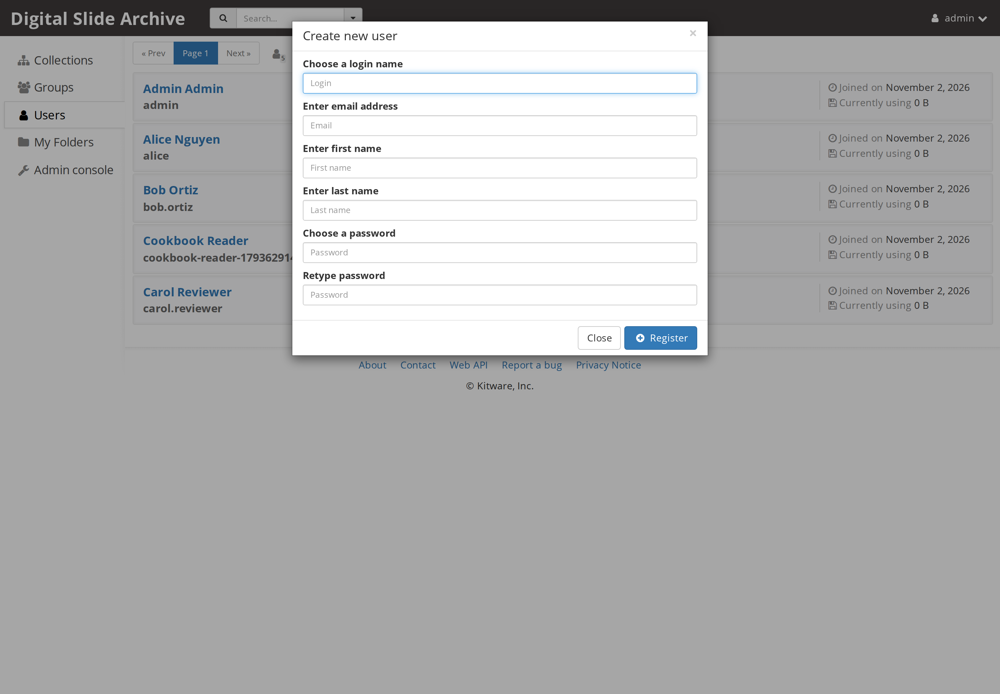
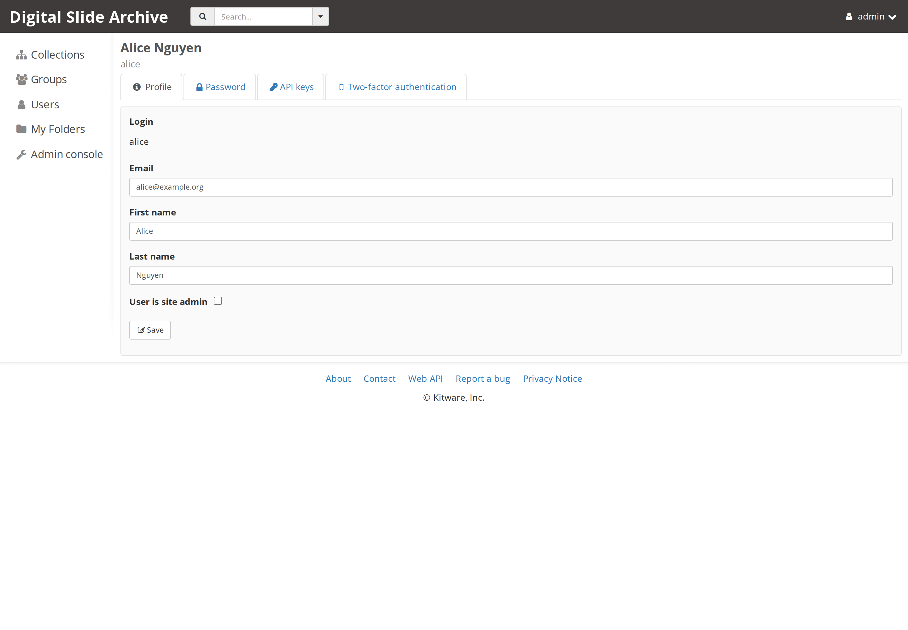
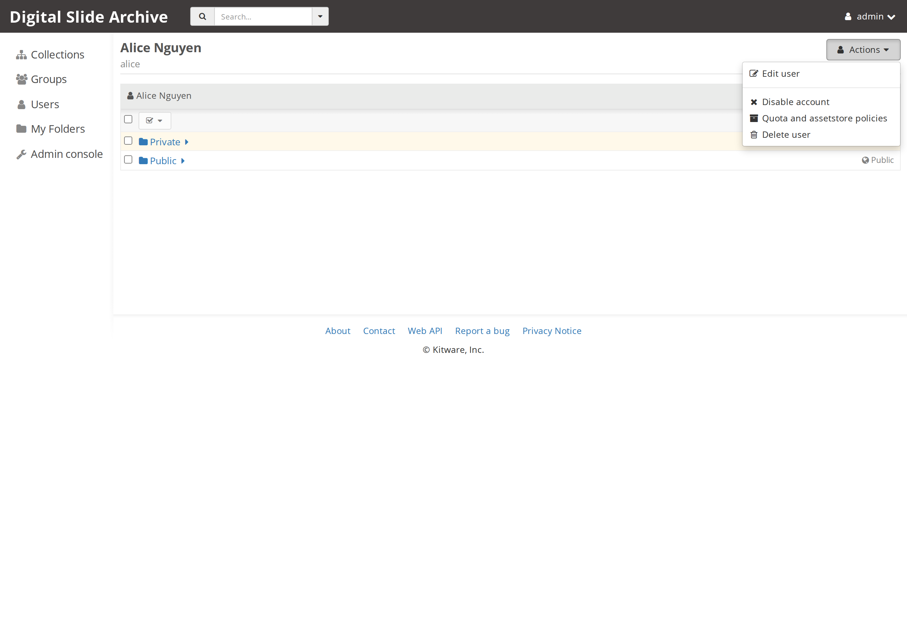
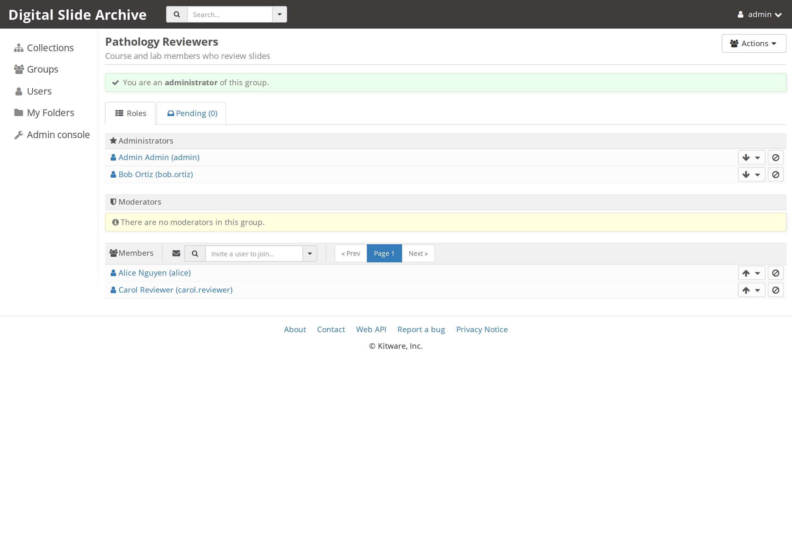

# Users, groups, and roles for operators

This page covers the account and group operations an operator performs in the
web console. It does not repeat the sharing model. For who can see or change a
collection, folder, item, file, or annotation, read
[Permissions and access control](../user-guide/permissions.md).

## Accounts and groups are different things

- An **account** is a Girder user: a login, an email address, a password, and a
  personal **My Folders** area.
- A **group** is a named set of accounts. Groups are used to grant access to
  resources and to organize people. Membership is independent of the account's
  site-admin flag.
- A **site admin** is an account with the global admin flag. Site admins can see
  and administer every account, group, collection, setting, and assetstore.

A user can be a member of many groups and still have no access to a particular
collection. A user can also have access to a collection without being in any
group, if the collection was shared with them directly. The group page manages
people; the collection's **Actions → Access control** page manages access.

## Create a user

1. Sign in as a site admin.
2. Open **Users** (`http://localhost:8080/#users`).
3. Choose **Create user**.
4. Fill in login, email, first name, last name, and the password twice.
5. Choose **Register**.

The web form creates a normal, non-admin account. The account is created with
the default personal folders configured on the instance. The stock setting is
**Public and Private**, so a new user starts with two folders under **My
Folders**:

| Folder | Initial access |
| --- | --- |
| `Private` | Private to the user |
| `Public` | Public read access |

The folder names and the existence of the pair are not security boundaries; they
are a starting layout. The operator can change the default with **Server
configuration → Create default folders for new users** (set it to **No** to
create no default folders). See [settings](settings.md#administrative-policy).

If the instance allows open registration, users can also create their own
accounts from the sign-in dialog. Registration policy and email verification are
operator settings; see [settings](settings.md#administrative-policy).

### Reset a password

Open the user and choose **Actions → Edit user**, then the **Password** tab:

Enter the new password twice and choose **Change**. The user can also change
their own password from **My account → Password**. This is the supported way to
recover an account; do not edit the MongoDB user document.

## Grant or remove the site-admin flag

Open the user, choose **Actions → Edit user**, and use **User is site admin**:

Check the box and choose **Save** to grant admin access. Uncheck it to remove
admin access.

A site admin bypasses normal per-resource access checks and can administer the
whole instance. Grant the flag to as few people as possible, and make sure at
least one other working admin account exists before you remove your own flag.

The flag is separate from group roles. Making someone a group administrator does
not make them a site admin, and making them a site admin does not add them to any
group.

## Disable and re-enable an account

Open the user and choose **Actions → Disable account**:

The console confirms with a **Disabled user account** message. A disabled account
cannot sign in; Girder rejects authentication with an "Account is disabled"
error. Disabling does not delete the account, remove group memberships, or free
the files in the user's folders.

After disabling, the same **Actions** menu shows **Enable account**. Choose it to
restore sign-in. The account keeps its login, email, groups, and data.

Disabling is the right response to a departed collaborator or a compromised
account when you need to preserve the data and the audit trail.

## Delete an account

**Actions → Delete user** is destructive. Girder deletes the account and its
authentication tokens, pending group invitations, and the folders under the
user's **My Folders** area, including their items and file records. Uploaded
content may be removed from the assetstore during that cleanup; imported files
are left on disk by Girder's filesystem adapter. Either way, the account is not
reassigned and the data is not moved for you.

Before deleting:

1. Copy or transfer anything the user owns that must be kept.
2. Check collections and shared folders where the user is the owner or the last
   manager.
3. Confirm that the account is not the only site admin.
4. Prefer **Disable account** if you are not certain.

## Groups and group roles

These are Girder's built-in group roles. The generic group model, including
public groups and invitation behavior, is documented in the upstream
[Girder user guide](https://girder.readthedocs.io/); this page covers the
operator-facing screens and the DSA defaults.

Create a group from **Groups → Create Group**. The creator becomes an
administrator member of the new group automatically.

Open a group to manage it. The **Roles** tab lists administrators, moderators,
members, and pending invitations:

| Role | What it allows on the group |
| --- | --- |
| Administrator | Manage membership, promote members, edit the group, and delete the group |
| Moderator | Add and remove members and edit the group |
| Member | Belong to the group; no group management |

Group roles control the group, not its resources. To give a group access to a
collection or folder, use that resource's **Access control** dialog and add the
group as a principal. The full model, including inheritance and annotation
access flags, is in [Permissions and access control](../user-guide/permissions.md).

### Default groups

The stock instance does not create a default group and does not add new users to
a group. A newly created test account belonged to no groups until it was added.
If your deployment needs every user in a common group, create the group and add
the accounts, or automate it through the
[REST API](../reference/rest-api.md).

### Direct addition versus invitations

**Server configuration → Allow members to be directly added to groups** controls
whether group administrators and moderators can add people without an
invitation. The stock setting requires an invitation that the user accepts. The
group page's pending list is where outstanding invitations appear.

## Registration and account policy

These operator settings affect new accounts, not existing ones:

| Setting | Where | Effect |
| --- | --- | --- |
| Registration policy | **Server configuration → Administrative Policy** | Open registration, closed registration, or admin approval |
| Email verification | **Server configuration → Administrative Policy** | Required, optional, or disabled |
| Create default folders for new users | **Server configuration → Administrative Policy** | Creates the Public/Private pair or no folders |
| Enable API keys | **Server configuration** | Allows users to create API keys for scripts |
| Enable password login | **Server configuration** | Allows password authentication; turn off only when another login method is configured |
| Disable anonymous access | **Server configuration** | Requires sign-in for all pages |

The instance used for this page has open registration, email verification
disabled, and default folders enabled. These are useful defaults for a private
lab instance; review them before exposing the instance to the internet. The
settings page gives the restart behavior for each group.

??? note "Source and version"

    Account creation, the admin flag, password reset, disabling, and group roles
    were checked on a live local DSA 5 instance on 2026-11-13. The delete
    behavior and the disabled-login rejection were verified against Girder
    `5.0.23.dev5+g70eb94dcd` source (`girder/models/user.py` and
    `girder/api/v1/user.py`); a temporary account and its folders were deleted
    as part of the test.

    | Item | Value |
    | --- | --- |
    | DSA / Girder | `5.0.23.dev5+g70eb94dcd` |
    | HistomicsUI | `1.8.1.dev208+gee5f4c0da.d20261030` |
    | Deployment files | `devops/ver5` at `2e16b9a` |
    | Web address | `http://localhost:8080` |
