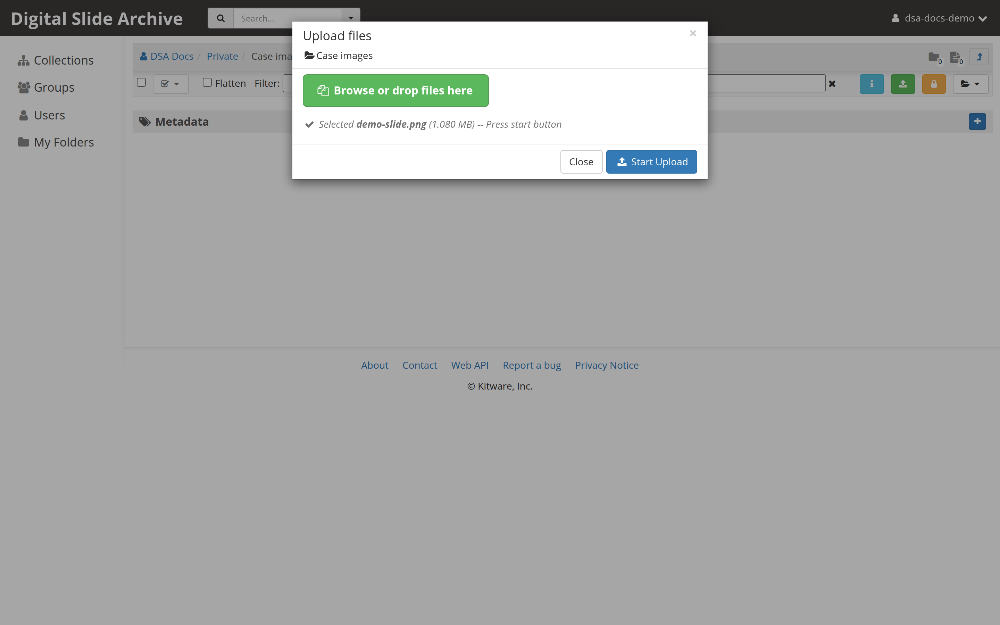
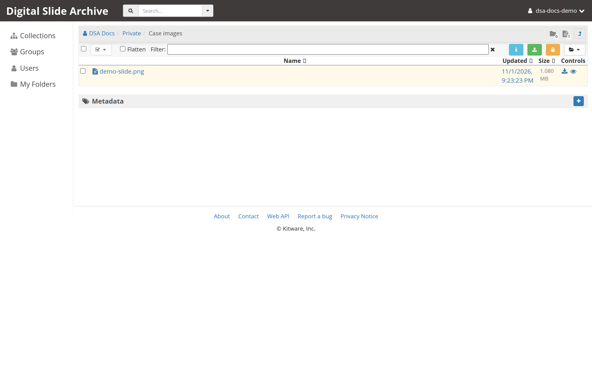

# Upload and view your first slide

This page assumes you have a running DSA instance from
[Install on one machine](install.md). It walks through creating a place to put
an image, uploading a slide, and opening it in HistomicsUI.

DSA organizes data in a hierarchy:

```text
Collection
└── Folder
    └── Item
        └── File
```

An image file is uploaded into a folder. DSA groups the file into an **item**,
and `large_image` reads that item as a slide.

## 1. Sign in

Open <http://localhost:8080> and sign in as `admin` with password `password`.

Change the default password before you let anyone else use the instance. The
administrator controls are under the user menu and the **Admin console**.

## 2. Create a collection and a folder

1. Open **Collections** in the navigation.
2. Create a collection, for example `My slides`.
3. Open the collection and create a folder, for example `Test uploads`.

Collections and folders carry permissions. Keeping test data in its own folder
makes it easy to remove later.

## 3. Upload a slide

1. Open the folder you created.
2. Use the folder's upload control, or drag the slide file into the folder view.
3. Wait for the upload to finish. Whole-slide images are large; a slow transfer
   is normal.



When the upload completes, the file appears as an item in the folder. DSA does
not add sample data by default, so this is your first item.



## 4. Open the slide

1. Click the item to open its item page.
2. If `large_image` recognizes the file, the item header shows
   **Open in HistomicsUI**. Click it.
3. The viewer opens at a URL like:

    ```text
    http://localhost:8080/histomics/#?image=<item-id>
    ```

    The default HistomicsUI webroot path is `histomics`. `hui` is also
    available.

If the button is missing, `large_image` did not recognize the file as a large
image. Check the file format, convert it to a pyramidal TIFF or OME-TIFF, and
upload it again. See [Unsupported formats](../troubleshooting.md#unsupported-format)
and the format row in the [install troubleshooting table](install.md#troubleshooting).

## 5. Navigate the image

- Drag with the left mouse button to pan.
- Use the mouse wheel or right-drag to zoom.
- Drag in the overview panel to jump to another region.
- Open the annotation and analysis panels from the viewer controls.

The full list is in [Mouse and keyboard controls](../user-guide/controls.md).

## Optional: load sample data and run a test task

The reference deployment includes a CLI test script that downloads sample data
and runs nuclei detection with HistomicsTK. From `devops/dsa`:

```bash
python3 utils/cli_test.py dsarchive/histomicstk:latest --test
```

It prompts for the administrator login and password. You need Python 3.6 or
later and the `girder-client` package. The analysis task also needs a connected
worker and working Docker socket access.

This command was **not executed** in the documentation environment because no
DSA instance or Docker daemon was available there. It is transcribed from
`devops/dsa/README.rst` at commit `2e16b9a`.

## Next

- [Mouse and keyboard controls](../user-guide/controls.md)
- [Next steps](next-steps.md)
