# Install on Ubuntu 24.04 (DSA 5)

This is a complete, verified walkthrough of a local Digital Slide Archive (DSA)
install on Ubuntu 24.04 using the `devops/ver5` Docker Compose stack. It assumes
Docker is already installed and working.

**Result:** a DSA 5 instance at `http://localhost:8080`, with Girder,
HistomicsUI, large_image, DICOMweb, Slicer CLI Web, the worker, MongoDB,
RabbitMQ, and Redis all running in Docker.

!!! info "What was verified"

    This walkthrough was run end to end on a clean host on 2026-11-02. Commands
    and version claims below are frozen at that run; report corrections rather
    than editing them silently.

    | Item | Value |
    | --- | --- |
    | Host OS | Ubuntu 24.04.5 LTS (kernel 6.8.0-147-generic, x86_64) |
    | Docker Engine | 29.9.2 |
    | Docker Compose | v5.6.1 |
    | Repository | `https://github.com/digitalSlideArchive/digital_slide_archive` |
    | Checked-out commit | `2e16b9a` (Merge pull request #538 from DigitalSlideArchive/update-trivy) |
    | Install directory | `~/devel/digital-slide-archive` |
    | DSA version reported by the API | `5.0.23.dev5+g70eb94dcd` |
    | Web address | `http://localhost:8080` |

!!! note "Which install guide is this?"

    This page covers the **DSA 5** stack in `devops/ver5`. For the older Girder 3
    reference deployment in `devops/dsa`, see
    [Install on one machine](install.md). The commands are not interchangeable.

!!! tip "Print or share this guide"

    Download the print-ready [PDF](../assets/downloads/DSA-Ubuntu-24.04-Install-Guide.pdf),
    or the
    [complete bundle](../assets/downloads/DSA-Ubuntu-24.04-Install-Bundle.zip)
    with the Markdown source, self-contained HTML, PDF, all screenshots,
    `start.sh`, and the raw terminal transcripts. The PDF and HTML are
    self-contained and can be shared without the screenshot folder.

## 1. Check Docker and the host

Run these commands first. They confirm the OS, the Docker engine, the Compose
plugin, and that your user can talk to the Docker daemon.

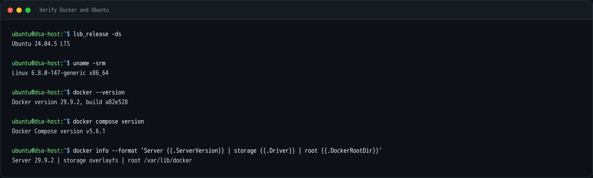

```bash
lsb_release -ds
uname -srm
docker --version
docker compose version
docker info --format 'Server {{.ServerVersion}} | storage {{.Driver}} | root {{.DockerRootDir}}'
```

Expected: Ubuntu 24.04.x, Docker 2x or newer, and a Compose v2+ plugin.

### If you get "permission denied" on the Docker socket

A freshly installed Docker daemon only lets members of the `docker` group use
it. If `docker info` fails with `permission denied while trying to connect to
the Docker API at unix:///var/run/docker.sock`, add yourself to the group and
start a fresh login session:

```bash
sudo usermod -aG docker "$USER"
# log out and back in, or run:
newgrp docker
```

Verify again with `docker info`. You should not need `sudo` for the rest of this
guide.

### Hardware and disk

- 2 CPU cores and 8 GB RAM is enough to boot the stack and click around.
- Plan on roughly 8–12 GB of disk for the container images plus the database
  and assetstore.
- The first image pull is the slow part. Later starts are fast because the
  images are cached.

## 2. Clone the repository

DSA keeps its deployment files in the same repository as the application.
Clone it into `~/devel`:

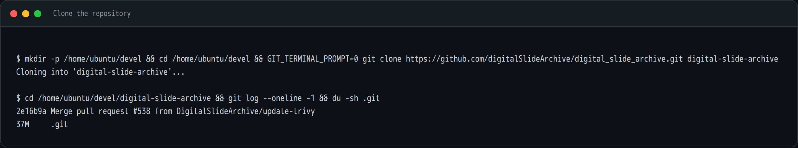

```bash
mkdir -p ~/devel
cd ~/devel
git clone https://github.com/digitalSlideArchive/digital_slide_archive.git digital-slide-archive
cd digital-slide-archive
git log --oneline -1
```

The result is `~/devel/digital-slide-archive`. This guide was written against
commit `2e16b9a`.

## 3. Look at the `devops/ver5` stack

The version 5 Compose stack lives in `devops/ver5`:

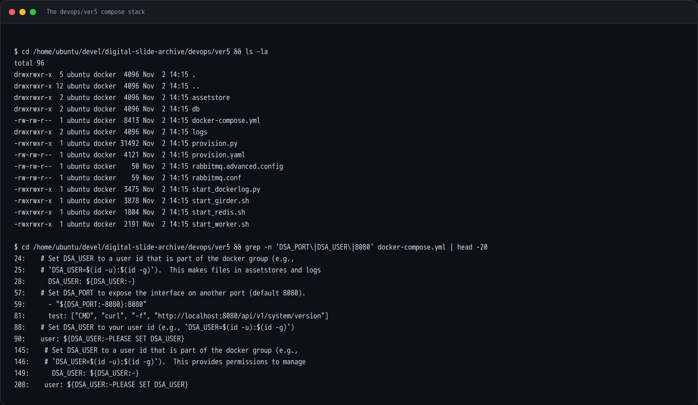

```bash
cd ~/devel/digital-slide-archive/devops/ver5
ls -la
```

Important files and directories:

| Path | Purpose |
| --- | --- |
| `docker-compose.yml` | Defines the `girder`, `worker`, `mongodb`, `rabbitmq`, `redis`, and `logging` services |
| `provision.py`, `provision.yaml` | Creates the initial admin user, collections, and plugin settings |
| `assetstore/` | Bind-mounted assetstore for uploaded files |
| `db/` | Bind-mounted MongoDB data directory |
| `logs/` | Bind-mounted application logs |
| `start_girder.sh`, `start_worker.sh` | Container entry points that honor `DSA_USER` |

Two details in `docker-compose.yml` matter for a local install:

- Girder is published on `${DSA_PORT:-8080}:8080`. The default is
  `http://localhost:8080`.
- `DSA_USER` controls the UID/GID used for files written to `assetstore/`,
  `db/`, and `logs/`. If it is omitted, files can end up owned by `root`.

## 4. Create the start script

Create a small `start.sh` next to the Compose file. It always brings the stack
down first, then starts it detached as your user.

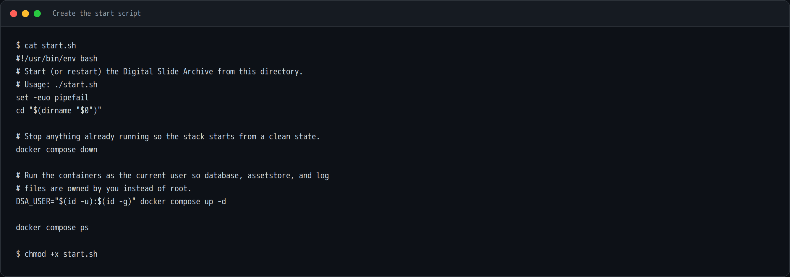

```bash
cat > start.sh <<'EOF'
#!/usr/bin/env bash
# Start (or restart) the Digital Slide Archive from this directory.
# Usage: ./start.sh
set -euo pipefail
cd "$(dirname "$0")"

# Stop anything already running so the stack starts from a clean state.
docker compose down

# Run the containers as the current user so database, assetstore, and log
# files are owned by you instead of root.
DSA_USER="$(id -u):$(id -g)" docker compose up -d

docker compose ps
EOF

chmod +x start.sh
```

Why these lines matter:

- `docker compose down` makes the script safe to run repeatedly. It removes the
  containers and network but keeps the bind-mounted data.
- `DSA_USER="$(id -u):$(id -g)"` passes your host UID/GID into the containers so
  the bind-mounted files stay owned by you.
- `up -d` runs in the background. The command returns before Girder has
  finished starting.

## 5. Pull the images

Pull once before the first start. This avoids waiting for a build and makes the
first boot much more predictable.

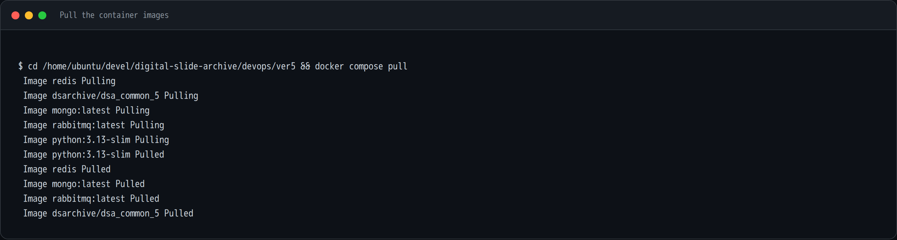

```bash
docker compose pull
```

The stack uses:

- `dsarchive/dsa_common_5` for both `girder` and `worker`
- `mongo:latest`
- `rabbitmq:latest`
- `redis`
- `python:3.13-slim` for the container-log collector

The DSA image is the large one. Expect several minutes and several GB on a first
pull; on later runs this step is quick because the layers are cached.

## 6. Start the stack

Run the script:

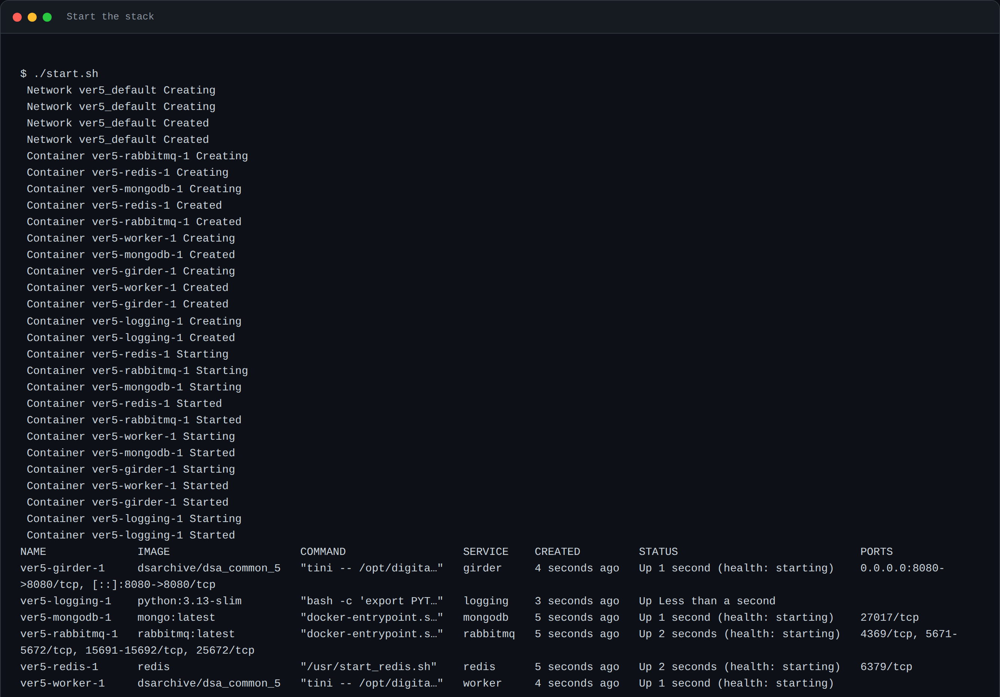

```bash
./start.sh
```

You will see Compose create the network and the six containers:

| Container | Role |
| --- | --- |
| `ver5-girder-1` | Web application and REST API (port 8080) |
| `ver5-worker-1` | Girder Worker / Celery worker for analysis jobs |
| `ver5-mongodb-1` | Database |
| `ver5-rabbitmq-1` | Broker for the worker |
| `ver5-redis-1` | Cache and notification backend |
| `ver5-logging-1` | Collects container logs into `logs/` |

On the first run, Girder also creates the admin user and the default
collections. Give it a minute or two.

!!! note "A note about health status"

    `docker compose ps` may report `health: starting` for Girder for several
    minutes because the healthcheck interval in the Compose file is five
    minutes. The application can already be serving requests while Docker still
    shows `starting`. Confirm readiness with the API check below rather than
    waiting on the label.

## 7. Verify that DSA is up

Check the containers and ask the API for its version:

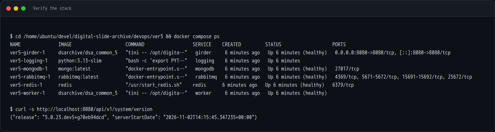

```bash
docker compose ps
curl -s http://localhost:8080/api/v1/system/version
```

A healthy API response looks like:

```json
{"release": "5.0.23.dev5+g70eb94dcd", "serverStartDate": "2026-11-02T14:15:45.347235+00:00"}
```

If the `curl` command hangs or refuses the connection, give Girder another
minute and check its log:

```bash
docker compose logs --tail=80 girder
```

Look for `==== Starting Girder ====` and the plugin list. A healthy first boot
loads `large_image`, `large_image_annotation`, `histomicsui`, `dicomweb`,
`slicer_cli_web`, `worker`, and the other DSA plugins.

## 8. Open DSA in a browser

Browse to **http://localhost:8080**.

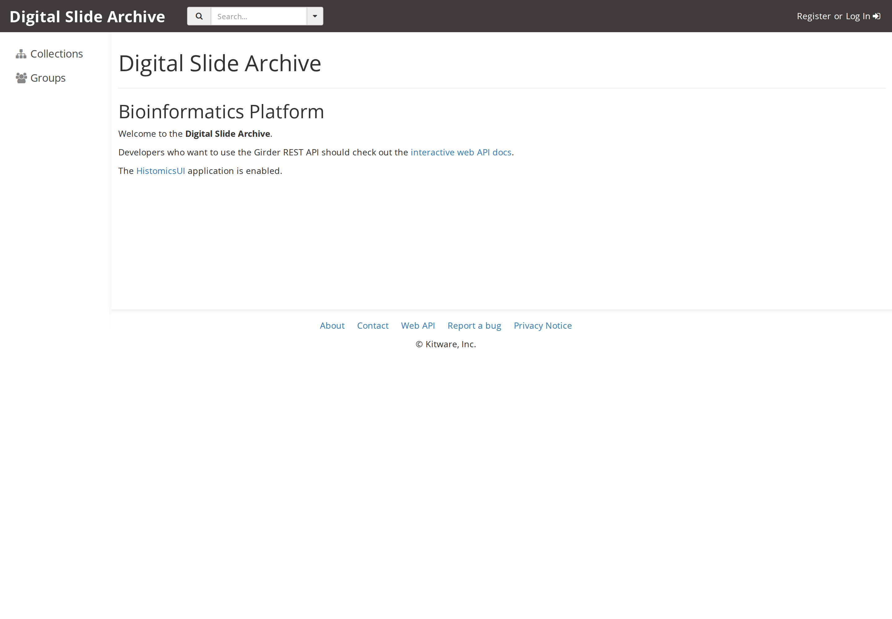

The stock `devops/ver5` provisioning creates one admin account:

| Username | Password |
| --- | --- |
| `admin` | `password` |

Click **Log In**:

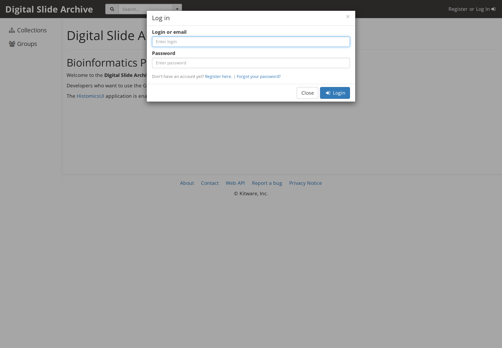

After signing in, the navigation bar shows the admin console, collections,
groups, and users:

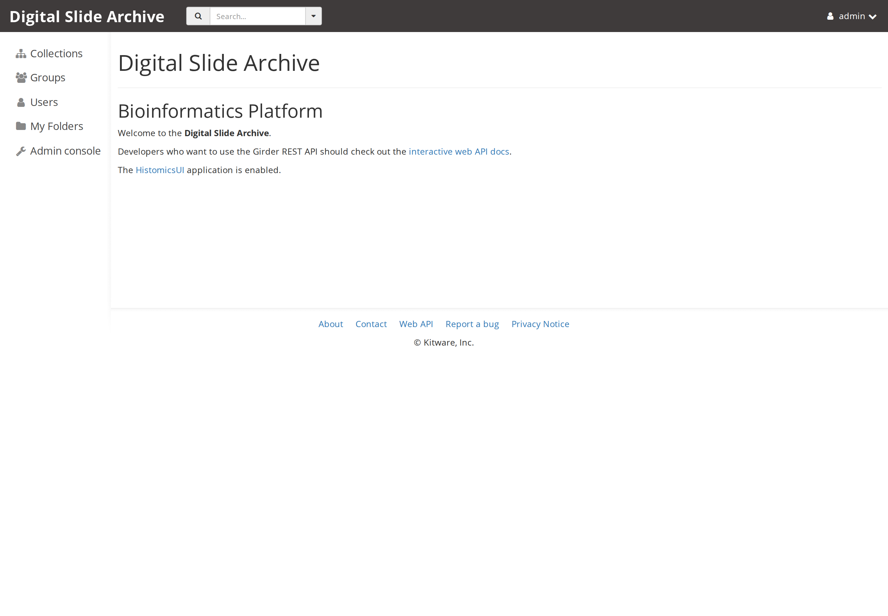

!!! warning "Change the default password"

    Change the default admin password before putting this instance on a shared
    network. Use **My account → Password** in the web UI.

### Verify the plugins

Open **Admin console → Plugins** (or go directly to
`http://localhost:8080/#plugins`). This page shows the installed plugin set and
the DSA version:

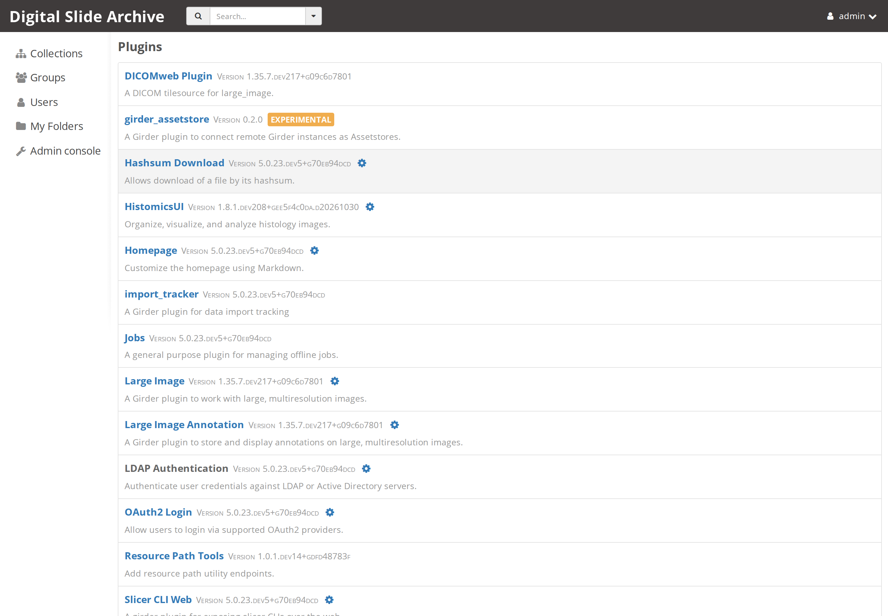

You should see `HistomicsUI`, `large_image`, `DICOMweb`, `Slicer CLI Web`,
`Worker`, and the rest of the DSA plugin stack. The DSA release is shown at the
top of the page.

### Open HistomicsUI

HistomicsUI is the digital-slide workspace and is the entry point for slide
viewing and analysis:

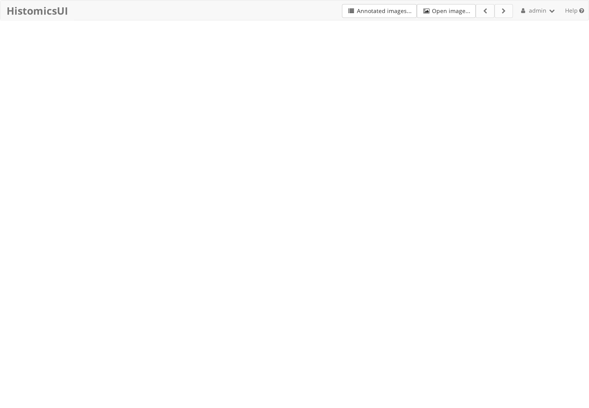

Use **Open image…** after uploading a slide to open the viewer. For this install
check, simply seeing the authenticated HistomicsUI landing page is enough to
confirm that the web application, authentication, and plugin routing are
working.

## 9. Day-to-day commands

Run these from `~/devel/digital-slide-archive/devops/ver5`.

| Task | Command |
| --- | --- |
| Start or restart everything | `./start.sh` |
| Start in the foreground (see all logs) | `DSA_USER=$(id -u):$(id -g) docker compose up` |
| Stop the stack | `docker compose down` |
| Show status | `docker compose ps` |
| Follow Girder logs | `docker compose logs -f girder` |
| Follow worker logs | `docker compose logs -f worker` |
| Open a shell in Girder | `docker compose exec girder bash` |
| Check the API version | `curl -s http://localhost:8080/api/v1/system/version` |
| Use a different host port | `DSA_PORT=8081 ./start.sh` |

### Where the data lives

- Uploaded files: `devops/ver5/assetstore/`
- MongoDB data: `devops/ver5/db/`
- Application logs: `devops/ver5/logs/`

Because these are bind mounts, `docker compose down` does **not** delete them.
To reset to a completely fresh instance, stop the stack and remove those three
directories:

```bash
docker compose down
rm -rf assetstore/* db/* logs/*
./start.sh
```

!!! danger "This is destructive"

    Take a backup first if the instance has data you care about.

## 10. Troubleshooting

**`permission denied ... /var/run/docker.sock`**
Your shell is not in the `docker` group yet. Run `sudo usermod -aG docker
"$USER"`, then log out and back in (or `newgrp docker`), and retry.

**`Bind for 0.0.0.0:8080 failed: port is already allocated`**
Something else is using port 8080. Start DSA on another port with
`DSA_PORT=8081 ./start.sh`, then browse to `http://localhost:8081`.

**Girder stays on `health: starting`**
This is expected for a while because the healthcheck interval is five minutes.
Check `curl -s http://localhost:8080/api/v1/system/version` and `docker compose
logs --tail=100 girder`. If the API responds, the instance is usable.

**The first start seems to hang**
The first boot runs database provisioning, creates the admin user, and
configures plugins. Watch `docker compose logs -f girder` and give it a few
minutes. Later starts are much faster.

**MongoDB exits or complains about memory maps**
The Compose file limits Mongo connections to reduce shared-memory demand. On a
small host, make sure the machine has enough RAM and that `vm.max_map_count` is
at least the Docker default (`262144`). Check with `sysctl vm.max_map_count`.

**Containers start but files in `assetstore/`, `db/`, or `logs/` are owned by root**
You started the stack without `DSA_USER`. Use the provided `start.sh`, or pass
`DSA_USER=$(id -u):$(id -g)` explicitly.

**I need to start completely over**
Stop the stack, remove the bind-mounted data as shown above, and run
`./start.sh`. Pulled images remain cached.

## Screenshot index

The screenshots follow the capture story. The numbers match the filenames in the
downloaded bundle.

| Screenshot | What it shows |
| --- | --- |
| `01-prerequisites.png` | Ubuntu, kernel, Docker, and Compose versions |
| `02-clone-repo.png` | Repository clone and checked-out commit |
| `03-ver5-directory.png` | The `devops/ver5` stack and its Compose settings |
| `04-start-script.png` | The `start.sh` script |
| `05-pull-images.png` | Pulling the five container images |
| `06-start-containers.png` | Compose creating and starting the six containers |
| `07-container-health.png` | `docker compose ps` and the DSA version API |
| `10-dsa-landing.png` | DSA landing page at `localhost:8080` |
| `11-dsa-login.png` | Login dialog |
| `12-dsa-home-admin.png` | Signed-in home page with admin navigation |
| `13-dsa-plugins.png` | Installed plugins and DSA release |
| `14-histomicsui.png` | HistomicsUI landing page |

## Next

- [Upload and view your first slide](first-slide.md)
- [Troubleshooting and FAQ](../troubleshooting.md)
- [Mouse and keyboard controls](../user-guide/controls.md)
