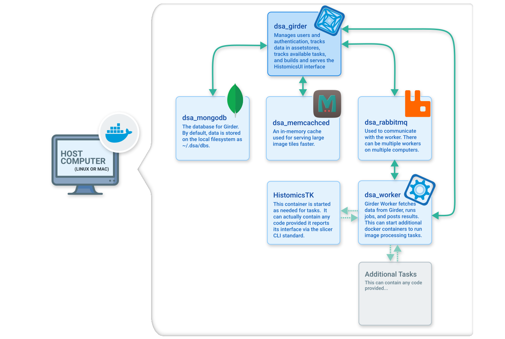
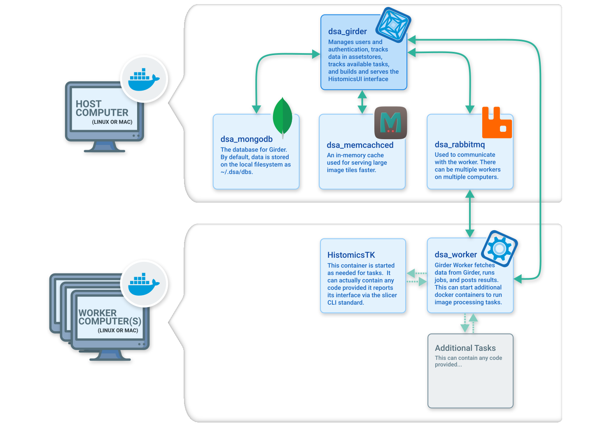

# System overview

The Digital Slide Archive is typically installed either on a single computer or
on one main computer with one or more worker machines that run image algorithms
invoked through HistomicsUI or the API. There are additional options, such as
hosting the database externally, but these are uncommon.

This page is adapted from the existing
[`docs/system-overview/`](https://github.com/DigitalSlideArchive/digital_slide_archive/tree/master/docs/system-overview)
page.

## Single computer setup

{ width="75%" }

The default installation runs on a single computer. This is the simplest way to
deploy DSA, though image analysis tasks are limited by the processing power of
one system.

Image and other data files, the database, and log files are all stored on the
local filesystem. Data files can also be stored in or imported from external
assetstores such as Amazon S3.

When `docker compose` is used with the default `docker-compose.yml` in
`devops/dsa`, five containers provide the services DSA needs. When an image
analysis task runs through HistomicsUI or the API — for example, detecting
nuclei on a whole-slide image with HistomicsTK — an additional container is
created for the task. That container exists only as long as the task needs it.
Results are stored back to the database and file assetstore.

## Distributed workers setup

{ width="75%" }

To expand computing power and accelerate image analysis, DSA can run on one main
computer with any number of worker machines.

Image and other data files, the database, and log files are stored on the main
computer's local filesystem, as in the single-computer configuration. Data files
can also be stored in or imported from external assetstores such as Amazon S3.

To start in this mode, see the instructions in the
[`devops/external-worker`](https://github.com/DigitalSlideArchive/digital_slide_archive/tree/master/devops/external-worker)
directory. Workers can be started or stopped at any time. For example, you can
add workers while running many tasks and stop them when they are no longer
needed. If a shared network filesystem is used, appropriate mount commands can
be added as additional options to both the main computer and the worker
commands; this can substantially reduce network traffic.

On the main computer, four containers provide most of the services DSA needs.
On each worker, one container starts initially. When an image analysis task
runs, an additional container is created on the worker for the duration of the
task. Results are stored back to the database and file assetstore.

With multiple workers, each worker receives tasks in turn until all are busy.
As workers finish, they receive new tasks. If a worker stops or loses
connectivity with a partially completed task, the task is reassigned to another
available worker. Worker computers do not need to be identical; faster workers
process more tasks than slower ones.

## Related

- [What is DSA?](get-started/what-is-dsa.md)
- [Install on one machine](get-started/install.md)
