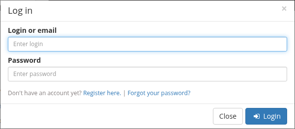
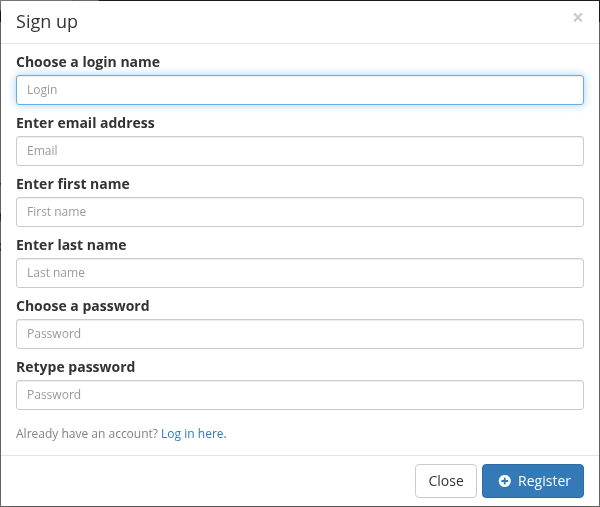

# Connect to a DSA server

This tutorial takes you from "I have a server address" to "I am signed in and
can see my data". It takes about two minutes.

## Before you start

You need:

- The web address of a DSA instance. A local install from
  [Install on one machine](../get-started/install.md) answers on
  <http://localhost:8080>. The public demo is
  <https://demo.kitware.com/histomicstk/>. Use your own address everywhere
  below.
- An account on that instance, or permission to create one.

!!! note "Address, not credentials"

    A DSA server is a web application. You connect with a browser; you do not
    install a desktop client. The only thing you need from your administrator
    is the URL and an account.

## 1. Open the server address

Enter the base address in your browser, for example:

```text
http://localhost:8080
```

or

```text
https://demo.kitware.com/histomicstk/
```

You should see the DSA home page with a navigation bar across the top and
**Register** / **Log In** links in the upper-right corner.

!!! tip "Use HTTPS in production"

    `localhost` over plain HTTP is fine for a local test. Any shared or
    internet-facing instance should be served over HTTPS.

## 2. Sign in

1. Select **Log In** in the upper-right corner.
2. In the **Log in** dialog, enter your **Login or email** and **Password**.
   If two-factor authentication is enabled on your account, also enter the
   **Two-factor code**.
3. Select **Login**.



The default administrator account on a fresh reference install is `admin` with
password `password`. Change that password immediately; see
[Upload and view your first slide](../get-started/first-slide.md#1-sign-in).

### If you do not have an account

If the server allows self-registration, the **Register** link is shown next to
**Log In**. Select it and fill in the **Sign up** dialog:

- **Choose a login name**
- **Enter email address**
- **Enter first name** and **Enter last name**
- **Choose a password** and **Retype password**

Then select **Register**. You are signed in after the account is created.



If there is no **Register** link, registration is closed on that server. Ask
the administrator to create an account for you.

## 3. Confirm that you are connected

When you are signed in:

- The upper-right corner shows your login name instead of **Register** and
  **Log In**.
- Selecting your name opens a menu with **My folders**, **My account**, and
  **Log out**.

If you still see **Log In**, the sign-in did not complete. Check the
troubleshooting table below.

## 4. Find your workspace

DSA stores data in two places you will use first:

| Location | What it is | Who can see it |
| --- | --- | --- |
| **Collections** | Shared, permission-controlled trees of folders and items. | Everyone with read access to the collection. |
| **My folders** | Your personal space, reached from the menu under your login name. | You, unless you grant access to others. |

Open **Collections** from the top navigation to browse shared data, or open
**My folders** to start in your own space. The
[Create a folder](create-a-folder.md) tutorial continues from either one.

## Connect from a script (optional)

For notebooks and command-line tools, use an API key instead of your password.
You can create one in the web interface.

1. Open the menu under your login name and select **My account**.
2. Select the **API keys** tab.
3. Create a key with a name you will recognize, such as `laptop-notebooks`.
4. Copy the key. The list has a **show** link if you need to reveal it again.

Then exchange the key for a session token and make a request:

```bash
export DSA_URL=https://your-dsa.example.com
export DSA_API_KEY=paste-your-key-here

TOKEN=$(curl -s -X POST "$DSA_URL/api/v1/api_key/token" \
  -d "key=$DSA_API_KEY" \
  | python3 -c 'import json,sys; print(json.load(sys.stdin)["authToken"]["token"])')

curl -s -H "Girder-Token: $TOKEN" "$DSA_URL/api/v1/user/me"
```

The last command returns your user record. Tokens expire; create a new one
rather than storing it indefinitely.

!!! note "API keys may be disabled"

    An administrator can turn off API keys for the instance. If the **API
    keys** tab or the create button is missing, use your username and password
    with the Python client instead. See the
    [Python client](../reference/python-client.md) reference.

## Troubleshooting

| Symptom | Likely cause | Fix |
| --- | --- | --- |
| The browser cannot reach the address | Wrong host or port, or the server is not running | Confirm the URL with your administrator. For a local install, check `docker compose ps` and open <http://localhost:8080>. |
| A certificate warning appears | Self-signed certificate on a test server | Only bypass it for a server you control. Production instances should use a trusted certificate. |
| **Login** fails with "Login failed" | Wrong login or password, or the account does not exist | Retry carefully; ask the administrator to reset the password if needed. |
| The **Register** link is missing | Self-registration is closed | Ask an administrator to create the account. |
| Sign-in succeeds but you see no data | You are signed in but have no read access to any collection | Open **My folders** to confirm your account works, then ask for access to the collection you need. |
| The API key request returns `Invalid API key` | The key was copied incorrectly, deleted, or deactivated | Create a new key and copy the whole value. |
| The API key request returns `API key functionality is disabled` | The administrator disabled API keys | Use username/password authentication instead. |

## Verified status

Checked on 2026-11-01 against the live test instance
<https://pub-data.bdsa.io/> (Girder API `5.0.20.dev2+ge191b30e7`), using a
headless Chromium browser while signed out, and against the Girder
`3.x-maintenance` source at
[`71e5fba`](https://github.com/girder/girder/commit/71e5fba).

Live checks: the home page shows **Register** / **Log In** in the upper-right
corner; the **Log in** dialog has **Login or email**, **Password**, and
**Two-factor code**; the **Sign up** dialog has **Choose a login name**,
**Enter email address**, **Enter first name**, **Enter last name**, **Choose a
password**, and **Retype password**.

Still **not live-tested**: signing in with an account, the signed-in user menu,
**My folders**, **My account**, and the API-key screens. Those remain
source-verified only.

## Next

- [Create a folder](create-a-folder.md)
- [Copy an item](copy-an-item.md)
- [Edit metadata](edit-metadata.md)
