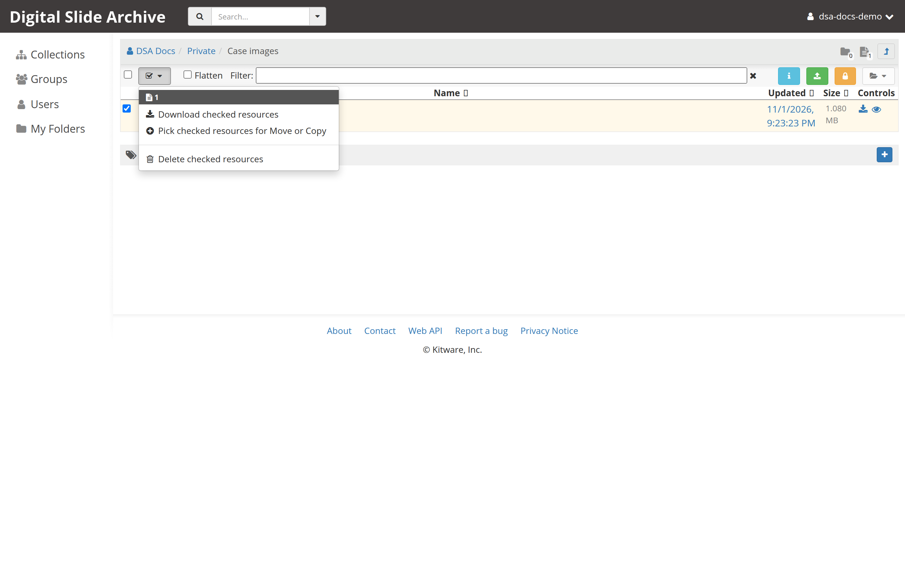
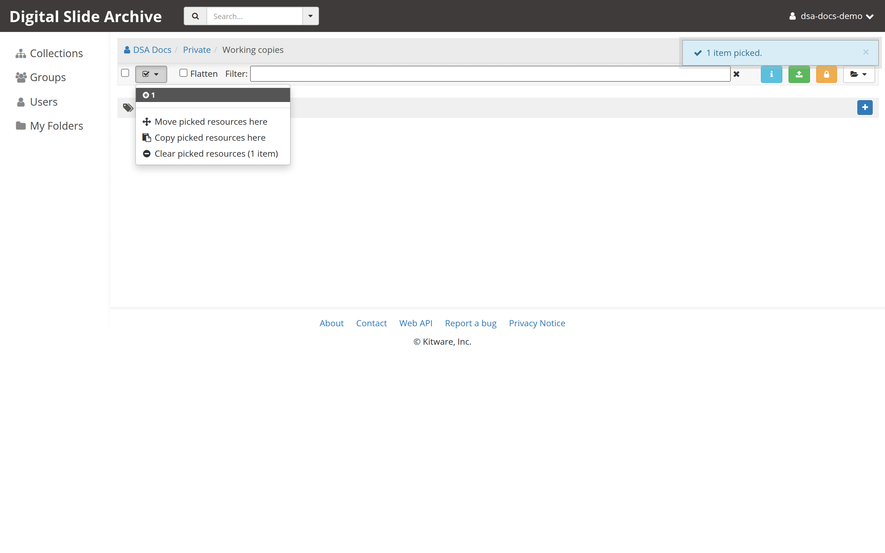
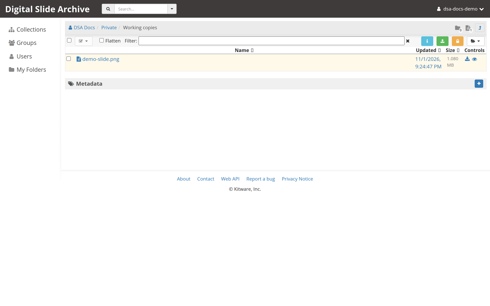

# Copy an item

Copying duplicates a slide — its files and its metadata — into another folder,
and leaves the original where it is. Use it to reuse a slide in a second
project, or to make a working copy before you annotate.

## What a copy contains

A copied item gets:

- the same name as the original,
- its own copy of every file in the original item,
- a copy of the original's metadata,
- a `copyOfItem` field that records the original item's ID.

The original stays in place. Later changes to either item do not affect the
other, except that they still share the same stored file content internally
where DSA can deduplicate it.

## Before you start

- You are signed in. If not, start with [Connect to a DSA server](connect.md).
- You can **read** the item you want to copy.
- You can **write** to the destination folder.

## 1. Open the source folder

Navigate to the folder that contains the item. Use the breadcrumb to confirm
the location.

## 2. Check the item

Each row in the item list has a checkbox at its left. Check the box next to the
item you want to copy.

The **Checked actions** menu at the left of the action bar becomes enabled and
shows how many items and folders are checked.

!!! note "Folders can be copied too"

    The same flow copies checked folders. Copying a folder also copies
    everything inside it.

## 3. Pick the item for copying

1. Open the **Checked actions** menu — the button with the check mark and a
   small triangle.
2. Choose **Pick checked resources for Move or Copy**.

The checked items are now *picked*. Picking does not change anything yet; it
only records what you intend to move or copy.

!!! warning "Do not reload the page"

    The picked selection is held in the browser tab. Reloading or closing the
    tab clears it, and you will have to pick the items again.

## 4. Go to the destination folder

Navigate to the folder that should receive the copy. Use **Collections**,
**My folders**, or the breadcrumb. You can move up and down the tree; the
picked items stay with the tab.

The **Checked actions** menu now has a different set of entries, because a
selection is active:

- **Move picked resources here**
- **Copy picked resources here**
- **Clear picked resources**

## 5. Copy the item here

1. Open the **Checked actions** menu.
2. Choose **Copy picked resources here**.

DSA copies the files and metadata. Large slides take longer; the page shows a
progress indicator while the copy runs.

When it finishes, the destination list refreshes and the new item appears with
the same name as the original. The selection is cleared automatically.

## 6. Verify the copy

- The item is listed in the destination folder.
- Opening it shows the same name, files, and metadata as the original.
- The original is still in the source folder.
- If you need evidence at the API level, `GET /api/v1/item/<id>` on the copy
  returns a `copyOfItem` field containing the original item's ID.

## Rename the copy

Both items currently have the same name. To tell them apart:

1. Open the copy.
2. Select **Actions** in the item header.
3. Choose **Edit item**.
4. Change **Name** and, if you like, **Description**.
5. Select **Save**.

Renaming the copy does not rename the original.

## Troubleshooting

| Symptom | Likely cause | Fix |
| --- | --- | --- |
| **Copy picked resources here** is missing | You do not have write access to the destination, or the page is a collection or personal-space page rather than a folder | Open a folder and try again. Items can only be copied into folders, and you need write access there. |
| The picked selection disappeared | The page was reloaded, or you cleared it | Check the item again and repeat the pick step. |
| The item appears twice in the destination | You copied it more than once | Delete the extra copy with **Actions** → **Delete item**. |
| The copy has no files | The copy was still running, or the source files are missing | Wait for the progress indicator to finish and reload. Check the original item's **Files & links** section. |
| `Copy` fails with a permission error | Read-only access to the source, or no write access to the destination | Request the missing access from the collection owner. |
| Two items have the same name and you cannot tell them apart | A copy keeps the original name | Open each item and compare the **Unique ID**, then rename the copy. |

## Verified status

**Live-tested** on 2026-11-01 against <https://pub-data.bdsa.io/> (Girder API
`5.0.20.dev2+ge191b30e7`) with a signed-in test account and headless Chromium.
Uploaded an image into one folder, checked it, picked it, copied it into a
second folder, and confirmed the copy appeared with the same name. The
screenshots above come from that run. Menu labels and `copyItem` behavior also
match the Girder `3.x-maintenance` source at
[`71e5fba`](https://github.com/girder/girder/commit/71e5fba).

## Next

- [Edit metadata](edit-metadata.md)
- [Create a folder](create-a-folder.md)
- [Upload and view your first slide](../get-started/first-slide.md)
