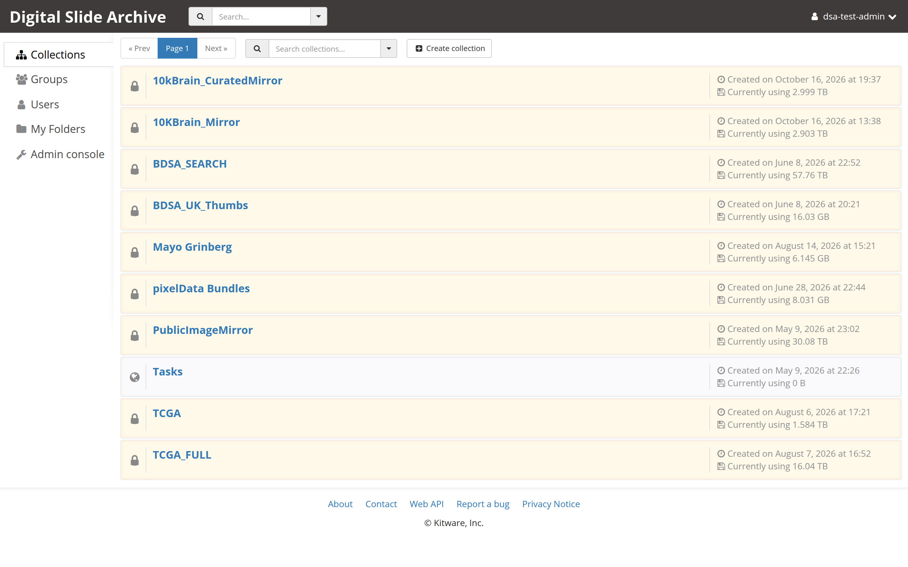
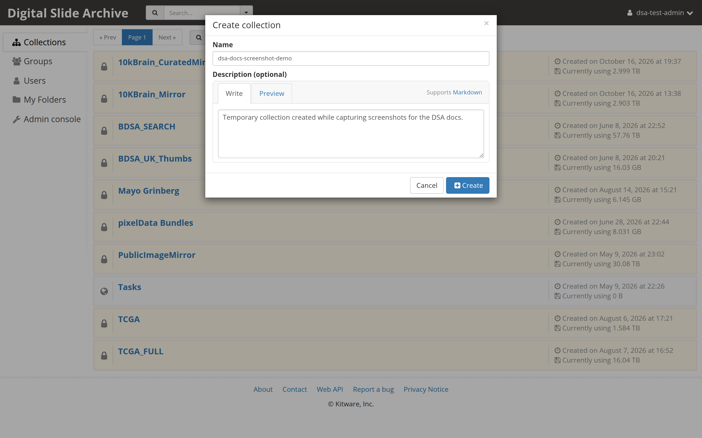
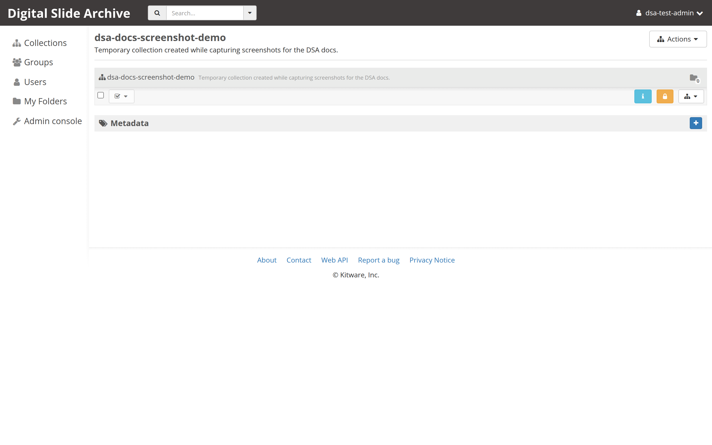
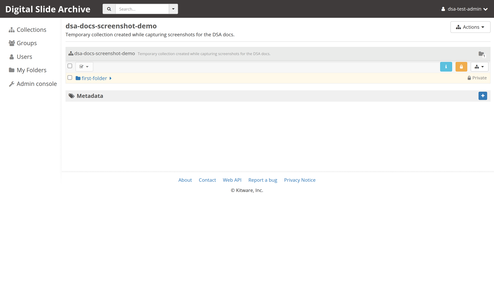

# Create a collection

A collection is the top level of a shared data tree. It holds folders, and the
folders hold slides and other items. Use a collection for a project, a study,
or any group of data that should share one set of permissions.

## Before you start

- You are signed in. If not, start with [Connect to a DSA server](connect.md).
- You can create a collection on this server. On most instances any signed-in
  user can; if the button is missing, ask an administrator.

Collections are separate from **My folders**, your personal space. Use a
collection when other people need access; use **My folders** for scratch work.

## 1. Open the Collections list

Select **Collections** in the top navigation. The page lists the collections
you can read.

## 2. Choose "Create collection"

Select **Create collection** at the right end of the toolbar above the list.

The **Create collection** dialog opens with two fields:

- **Name** — required. Use a short, stable name such as `kidney-study-2026`.
- **Description (optional)** — free text shown on the collection page.

## 3. Create it

Select **Create**. The dialog closes and the new collection opens.

A new collection is **private** by default: only you can see it until you grant
access. To share it, open the collection's action menu and select **Access
control**, then add users or groups.

## 4. Verify the result

- The breadcrumb reads `Collections / <your collection name>`.
- The browser address changes to a `#collection/<id>` route.
- The action menu for the collection offers **Edit collection** and **Access
  control**.
- The collection appears in the **Collections** list when you go back.

## 5. Add the first folder

1. Open the collection's action menu — the icon-only button with a small
   triangle at the right end of the action bar.
2. Select **Create folder here**.
3. Enter a **Name** and select **Create**.

Continue with [Create a folder](create-a-folder.md) for the details, or go
straight to [Copy an item](copy-an-item.md) once you have two folders.

## Troubleshooting

| Symptom | Likely cause | Fix |
| --- | --- | --- |
| There is no **Create collection** button | You are not signed in, or the server restricts collection creation | Sign in. If it is still missing, ask an administrator to create the collection or grant permission. |
| The **Create** button stays disabled | **Name** is empty | Enter a name. |
| Nobody else can see the collection | New collections are private | Open **Access control** and grant read access to the people or groups who need it. |
| Two collections have the same name | Duplicate names are allowed | Rename one with **Edit collection**, or use a naming convention. |
| You cannot delete the collection | You do not have admin access to it | Ask the collection owner, or an administrator, to delete it. |

## Next

- [Create a folder](create-a-folder.md)
- [Copy an item](copy-an-item.md)
- [Edit metadata](edit-metadata.md)

## Verified status

Live-tested end to end on 2026-11-01 against <https://pub-data.bdsa.io/>
(Girder API `5.0.20.dev2+ge191b30e7`) with an administrator test account. The
Collections list, the **Create collection** dialog, collection creation, and
creation of the first folder all succeeded. The test collection was deleted
afterward, so the screenshots contain no real study data.

On this instance collection creation is administrator-only: a non-admin test
account saw the dialog but received **"You are not authorized to create
collections."** If the **Create collection** button is missing for you, ask an
administrator for that permission; the rest of the flow is unchanged.
