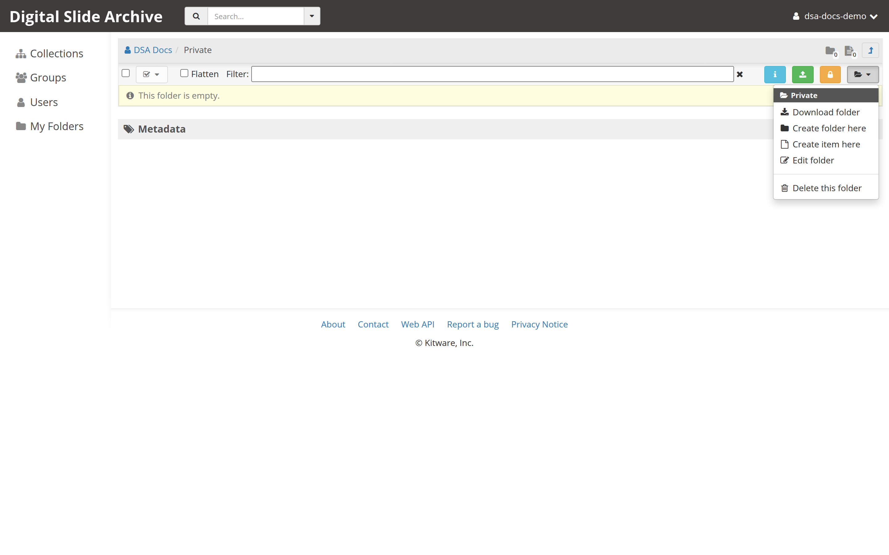
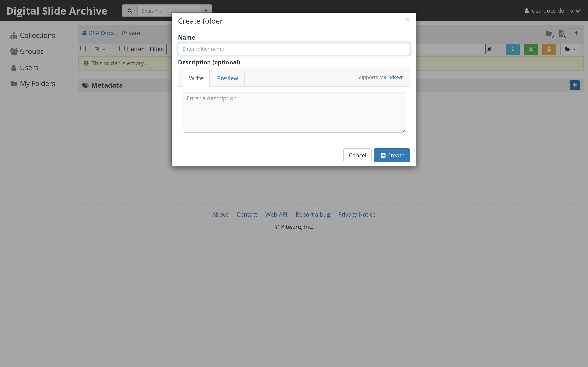
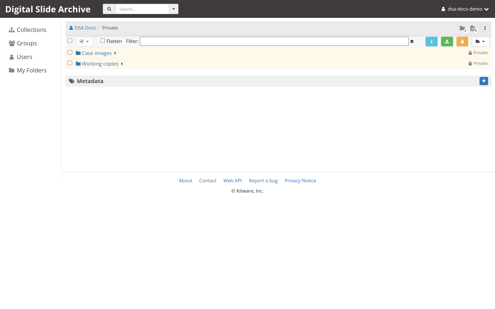

# Create a folder

Folders organize slides and other data inside a collection, or inside your
personal space. This tutorial creates one and checks that it is in the right
place.

## Before you start

- You are signed in. If not, start with [Connect to a DSA server](connect.md).
- You have **write** access to the parent location. If you can see a folder but
  not change it, you have read access only.

You can create a folder in three places:

| Parent | How to get there | Typical use |
| --- | --- | --- |
| **My folders** | Menu under your login name | Scratch space that belongs to you. |
| A **collection** | **Collections** in the top navigation | Shared project data. |
| An existing **folder** | Navigate down the folder tree | Subfolders for cases, stains, or batches. |

## 1. Open the parent location

Navigate to where the new folder should live. Use the breadcrumb at the top of
the page to confirm you are in the right place. For example:

```text
Collections / Demo / Kidney cases
```

Creating a folder inside the wrong parent is the most common mistake, so check
the breadcrumb before you continue.

## 2. Open the folder actions menu

At the right end of the action bar above the file list, select the icon-only
menu button marked with a small triangle. The icon matches the location: a
folder on a folder page, a sitemap on a collection page, or a person in your
personal space. Hovering over it shows a tooltip such as **folder actions** or
**collection actions**. The menu entries you need are the same in all three.



The menu shows the current location's name at the top and then actions such as:

- **Create folder here**
- **Create item here** (folders only)
- **Edit folder** / **Edit collection**
- **Delete this folder** / **Delete this collection**

If **Create folder here** is missing, you do not have write access to this
location.

## 3. Choose "Create folder here"

The **Create folder** dialog opens with two fields:

- **Name** — required. Use a short, stable name such as `2026-11-batch-01`.
- **Description (optional)** — free text for humans. Not used for access
  control.



Folder names do not have to be unique, so two folders in the same parent may
share a name. Pick a naming convention and keep it; future you will thank you.

## 4. Create the folder

Select **Create**. The dialog closes and the folder appears in the list. Its
row has a folder icon and, like other folders, can be opened by name.



## 5. Verify the result

- The new folder is listed in the parent you opened.
- Selecting it changes the breadcrumb, for example to
  `Collections / Demo / Kidney cases / 2026-11-batch-01`.
- The browser address changes to a `#folder/<id>` route.

Select the folder actions menu again; **Edit folder** should now be available,
which confirms you can write to it.

## What the folder does and does not do

- A new folder inherits nothing automatically from its parent except that it
  sits inside it. Access is controlled by the parent's permissions and any
  access you set on the folder itself.
- An empty folder is valid. You can upload slides into it now, or create
  subfolders first. See
  [Upload and view your first slide](../get-started/first-slide.md).
- Folders are containers, not files. A slide is an **item** inside a folder.

## Troubleshooting

| Symptom | Likely cause | Fix |
| --- | --- | --- |
| There is no **Create folder here** entry | You have read access only | Ask the owner for write access, or create the folder in **My folders**. |
| The **Create** button stays disabled | **Name** is empty | Enter a name. |
| The folder was created somewhere unexpected | Wrong parent | Open the folder, use **Edit folder** to rename it, then copy or move it to the right parent. |
| Two folders in the same parent have the same name | Duplicate names are allowed | Rename one with **Edit folder**, or adopt a naming convention that keeps them distinct. |
| You cannot see a folder you just created | The page still shows a cached list | Reload the page. |

## Verified status

**Live-tested** on 2026-11-01 against <https://pub-data.bdsa.io/> (Girder API
`5.0.20.dev2+ge191b30e7`) with a signed-in test account and headless Chromium.
Created two folders in **My folders**, confirmed both appeared in the parent
list, and opened them by name. The screenshots above come from that run. The
labels also match the Girder `3.x-maintenance` source at
[`71e5fba`](https://github.com/girder/girder/commit/71e5fba).

## Next

- [Copy an item](copy-an-item.md)
- [Edit metadata](edit-metadata.md)
- [Upload and view your first slide](../get-started/first-slide.md)
