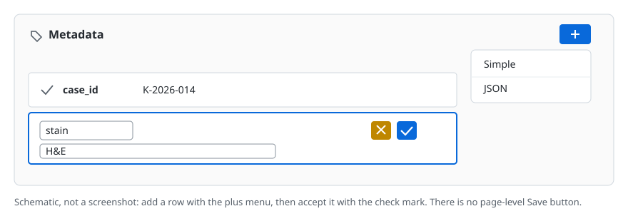

# Edit metadata

Metadata is a set of key and value pairs attached to an item, folder, or
collection. Use it for information that does not belong in the file itself:
case numbers, stain names, scanner settings, project codes, or review status.

!!! note "Metadata is not embedded file metadata"

    DSA metadata is stored in the archive database alongside the resource. It
    is separate from technical metadata inside the image file, such as EXIF or
    OME-XML. Editing one does not edit the other.

## Before you start

- You are signed in. If not, start with [Connect to a DSA server](connect.md).
- You have **write** access to the resource. Without it, the add and edit
  controls are hidden.

You can attach metadata to:

- an **item** (one slide or data object),
- a **folder**,
- a **collection**.

The controls are the same; only the page changes.

## 1. Open the resource

Open the item, folder, or collection. On an item page, scroll past **Info** to
the **Metadata** section. On a folder or collection page, the **Metadata**
section is below the list of folders and items.

## 2. Add a simple value

1. In the **Metadata** header, select the **+** button. Its tooltip is
   **Add Metadata**.
2. Choose **Simple**.
3. In the new row, enter a **Key** and a **Value**. For example:

    | Key | Value |
    | --- | --- |
    | `case_id` | `K-2026-014` |
    | `stain` | `H&E` |

4. Select the check mark button to save the row. The **X** button cancels it.



Saving happens per row. There is no page-level Save button, so add each key and
accept it before moving on.

## 3. Edit an existing value

1. Select the pencil icon at the left of the row.
2. Change the key, the value, or both.
3. Select the check mark to save, or the **X** to discard the change.

Use this to correct a typo or update a status. Changing a key is allowed; it is
not linked to anything else, so no other resource is affected.

## 4. Add a structured value

If a value needs to be a list or a nested object, add it as JSON instead:

1. Select **+** and choose **JSON**.
2. Enter the key.
3. Enter the value in the JSON editor. The editor offers a code view and a
   tree view.
4. Save the row.

For example, a key `stains` could hold:

```json
["H&E", "PAS"]
```

The key rules below still apply. The value can be any valid JSON value.

## 5. Delete a value

1. Select the pencil icon on the row.
2. Select the trash button.
3. Confirm if prompted.

Deleting a metadata key affects only that resource. Copies made earlier keep
their own copy of the metadata.

## Rules and behavior

- **Keys must not be empty.**
- **Keys must not contain a period (`.`).** DSA uses dots for nested database
  paths. Use underscores instead, for example `case_id`, not `case.id`.
- **Keys must not start with `$`.**
- A key is unique within one resource. Saving the same key again replaces the
  value.
- Metadata belongs to the resource you edit. Editing an item does not change
  its parent folder.
- Copying an item copies its metadata to the new item. See
  [Copy an item](copy-an-item.md).

## 6. Verify the result

- The saved row shows the key and value, and stays after a page reload.
- At the API level, `GET /api/v1/item/<id>` returns the pairs inside the
  item's `meta` object. The same applies to `folder` and `collection`.
- If you edit an item that has been copied, confirm that the original and the
  copy now differ as expected.

## Troubleshooting

| Symptom | Likely cause | Fix |
| --- | --- | --- |
| There is no **+** button in the **Metadata** header | You have read access only | Ask for write access to the resource. |
| The check mark does not save | The **Key** field is empty | Enter a key and select the check mark again. |
| An error mentions `"."` in the key | The key contains a period | Replace periods with underscores. |
| The JSON row will not save | The value is not valid JSON | Fix the syntax, or switch the row to **Simple** if the value is plain text. |
| A change disappeared | You selected **X**, or navigated away before saving | Edit the row again and select the check mark. |
| The value you see differs from the file's embedded metadata | They are separate systems | The Metadata panel is authoritative for DSA metadata; file-internal metadata is not changed by it. |

## Verified status

The metadata controls and key rules were checked against the JavaScript
served by the live test instance <https://pub-data.bdsa.io/> (Girder API
`5.0.20.dev2+ge191b30e7`) on 2026-11-01, and against the Girder
`3.x-maintenance` source at
[`71e5fba`](https://github.com/girder/girder/commit/71e5fba). The flow has not
been clicked through with a signed-in account, so it is source-verified, not
live-tested.

## Next

- [Copy an item](copy-an-item.md)
- [Create a folder](create-a-folder.md)
- [Mouse and keyboard controls](../user-guide/controls.md)
