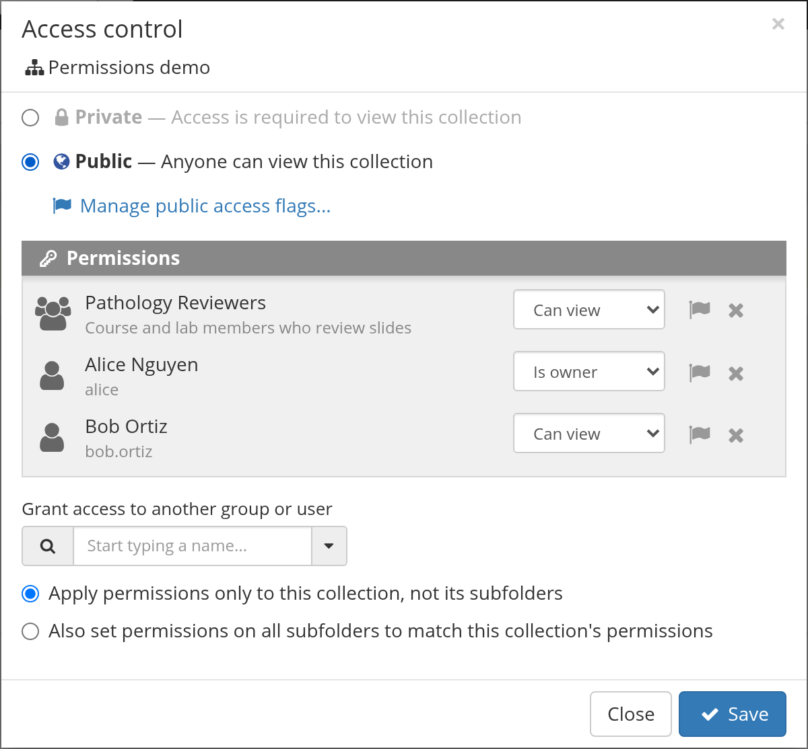
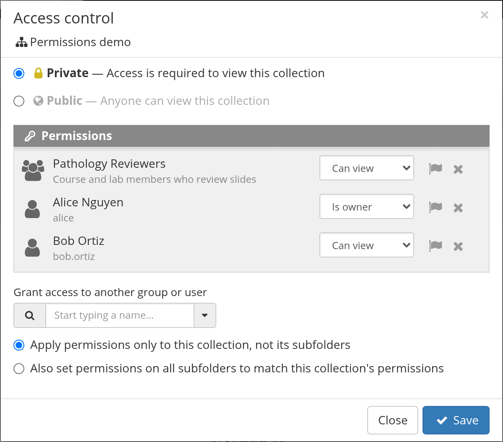
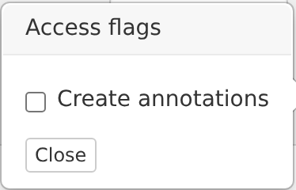
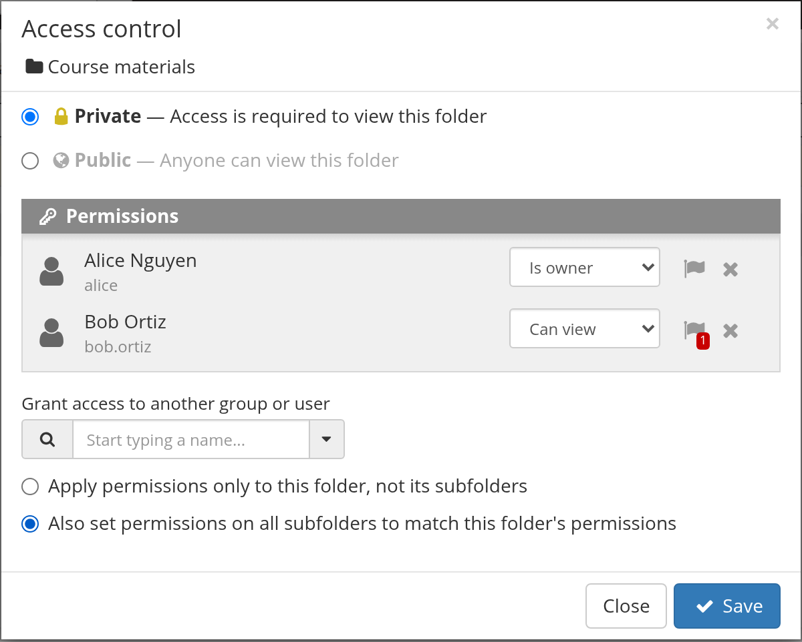
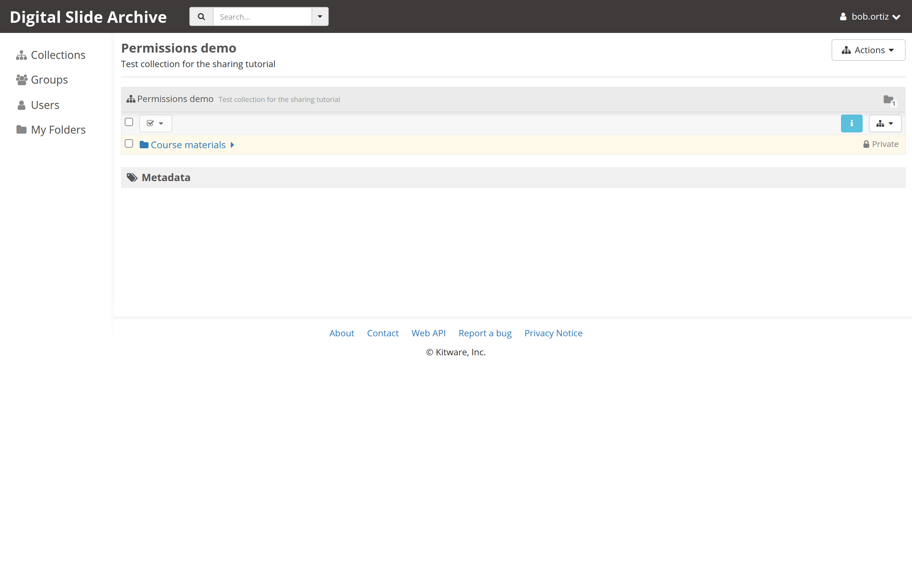

# Share a collection or folder

A collection or folder is visible only to you until you grant access. Sharing
means adding a user or a group to its **Access control** list and choosing a
role. Items inherit access from their folder, so you usually share the folder
once and every slide inside it becomes available.

Use this tutorial when a collaborator says "I can't see the study" or when you
need to let someone annotate without letting them edit or delete data.

## Before you start

- You are signed in. If not, start with [Connect to a DSA server](connect.md).
- You have **Is owner** (admin) access to the collection or folder. The person
  who created it normally does.
- You know whether to share with a **user** or a **group**. For a lab, course,
  or recurring project, create a group and share with the group once; membership
  changes then apply everywhere the group has access.
- You have decided how much access to give:

| Role in the dialog | Girder level | What it allows |
| --- | --- | --- |
| **Can view** | `READ` | View and download the collection or folder and its contents. |
| **Can edit** | `WRITE` | Everything in **Can view**, plus edit properties, add folders and items, and annotate (unless access flags say otherwise). |
| **Is owner** | `ADMIN` | Everything in **Can edit**, plus delete the resource and change its access list. |

Permissions are additive. A user gets the highest level granted to them
directly or through any group they belong to. A site administrator can always
take any action.

## 1. Open the Access control dialog

For a collection:

1. Select **Collections** in the top navigation.
2. Open the collection's action menu — the icon-only button with a small
   triangle at the right end of the action bar.
3. Select **Access control**.

For a folder, open the folder and use the same **Access control** item in the
folder's action menu.

The dialog is titled **Access control** and shows the collection or folder name
under the title.

## 2. Choose Private or Public

The top of the dialog has two choices:

- **Private — Access is required to view this collection/folder.** This is the
  default for a new collection.
- **Public — Anyone can view this collection/folder.** This includes anonymous
  visitors who are not signed in.

Public means **view only**. It does not grant edit or owner access. Leave the
resource private unless you specifically want unauthenticated visitors to see
it.

## 3. Grant access to a user or group

1. In **Grant access to another group or user**, start typing a name. The search
   matches both users and groups.
2. Select the person or group from the results.
3. They appear under **Permissions**. Use the drop-down beside the entry to set
   **Can view**, **Can edit**, or **Is owner**.
4. Repeat for every person or group that needs access.

Prefer one group over many individual entries. A group keeps the access list
short and makes onboarding and offboarding a membership change instead of a
per-resource edit.

## 4. Optional: grant an access flag

Some actions can be allowed without full **Can edit** access. Select the flag
icon beside a user or group to open **Access flags**. The DSA annotation plugin
registers **Create annotations**, which lets a user add annotations while
leaving the rest of the folder read-only.

Flags are additive: granting a flag never reduces a role. Use a flag when a
reviewer should annotate but not rename, move, or delete slides.

## 5. Choose what happens to subfolders

The dialog asks how far the change should reach. The wording follows the
resource: for a folder it says **this folder**, and for a collection it says
**this collection** and covers the folders inside it.

- **Apply permissions only to this folder, not its subfolders** — the current
  folder changes; subfolders keep their existing lists.
- **Also set permissions on all subfolders to match this folder's permissions**
  — the same list, including access flags, is written to every subfolder you
  have admin access to.

The second option replaces the access list on subfolders rather than merging it.
If a subfolder has a deliberately different list, choose the first option and
edit that subfolder separately.

## 6. Save and verify

Select **Save**. Then confirm the result:

- The other person can sign in and find the collection in **Collections**.
- A **Can view** user can open the collection and its folders. In the live
  test the action menus offered only **Download collection** and **Download
  folder**, with no edit or delete items.
- A **Can edit** user can add a folder or edit metadata.
- If the folder was made public, open its URL in a private browser window. You
  should be able to see it without signing in.

## Sharing one item instead of a whole folder

Items do not have their own access list; they inherit from the containing
folder. To share a single slide without exposing the rest of a folder, create a
separate folder, copy or move the slide into it, and share that folder.

## Annotation access behaves differently

Annotations are not plain items. Each annotation stores its own access list and
public flag, copied from the containing folder **when the annotation is
created**. The creator is then given admin access to that annotation.

This has consequences that surprise people:

- Sharing a folder later does **not** give collaborators access to annotations
  that already exist there. They see the slides but not the old annotations.
  Annotations created after the share are visible.
- Removing someone's folder access does not remove them from existing
  annotation access lists, although they still need folder read access to reach
  the annotations.
- Moving an item or annotation does not change the annotation's access list.
- Copying an item or folder copies annotations and gives the copies the
  destination folder's access, not the original annotation's access.

If you need to change access for existing annotations across a folder, use the
folder's **Annotation access control** action (available when you have admin
access to annotations in that folder). It **replaces** the access list on every
annotation it covers, so anyone omitted loses access. Subfolders are included
only when you check the subfolder option, and the dialog closes as soon as the
request is sent without waiting for the result.

## Troubleshooting

| Symptom | Likely cause | Fix |
| --- | --- | --- |
| **Access control** is missing from the action menu | You do not have **Is owner** access | Ask the collection or folder owner, or a site administrator, to grant it or make the change. |
| A collaborator still cannot see the collection | The entry was added to the wrong resource, the role is not saved, or they are signed in as a different account | Reopen **Access control**, confirm the entry and role, and have them refresh after signing in with the right account. |
| A collaborator can see slides but not annotations | Annotations were created before the folder was shared | Use **Annotation access control** for the existing annotations, or create new annotations after sharing. |
| A collaborator can view but cannot annotate | They have **Can view**, not **Can edit**, and no **Create annotations** flag | Raise the role to **Can edit** or grant the **Create annotations** access flag. |
| A subfolder kept its old access | The non-recursive option was chosen | Reopen the parent dialog and choose the subfolder option, or edit the subfolder directly. |
| Changing a folder did not change old annotations | Annotation access is copied at creation time | Use the folder's **Annotation access control** action. |

## Verified status

**Live-tested on 2026-11-02** against a local DSA 5 stack (Girder
`5.0.23.dev5+g70eb94dcd`, large_image `1.35.7.dev217+g09c6d7801`) with two
non-admin accounts: Alice as the collection owner and Bob as the collaborator.
The test covered the collection and folder **Access control** dialogs, the
private/public choice, adding a user and a group, applying **Can view**, setting
the **Create annotations** flag, and the recursive subfolder option. Bob could
see the shared collection, folder, and subfolder; his action menus offered only
download, and he received `403` when he tried to rename or delete them.
Anonymous access to a public collection returned the collection tree and
refused writes. The screenshots on this page come from that run; the test data
was created for the run.

Not exercised: the folder's **Annotation access control** bulk dialog. The
annotation ACL rules below are source-verified against `girder/large_image`
`docs/girder_annotation_access.rst` at commit `f4ad903`. Dialog labels were
also checked against Girder `AccessWidget.js` and the `accessEditor` templates
at commit `70eb94d`.

## Next

- [Permissions and access control](../user-guide/permissions.md)
- [Create a collection](create-a-collection.md)
- [Annotate a slide](annotate-a-slide.md)
