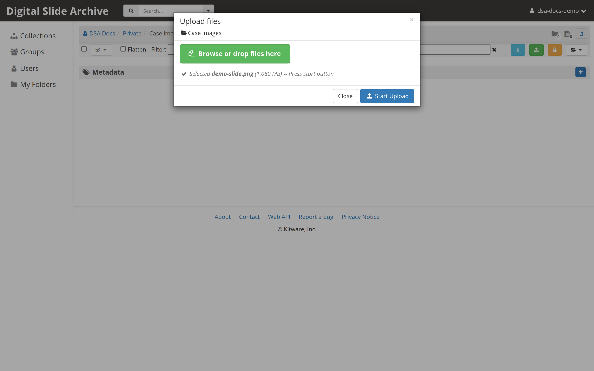

# Upload or import images

There are four common ways to get images into the Digital Slide Archive. They
fall into two groups:

- **Upload** copies the bytes into the DSA assetstore and creates the
  collection, folder, item, and file records.
- **Import** creates records that point at files that are already on a
  filesystem that DSA can reach. The bytes are not copied or moved.

Use this page to pick the right route, then follow the short procedure. Each
route has a full reference page where the mechanics are covered in more detail.

| Route | Use it when | Copies data? | Who can do it |
| --- | --- | --- | --- |
| [Drag and drop in the browser](#drag-and-drop-in-the-browser) | You have a few slides on your computer and want them in DSA now. | Yes | Anyone with **Can edit** on the destination folder |
| [Upload with `girder-client`](#upload-with-girder-client) | You are scripting an upload, moving dozens or hundreds of slides, or running from another server. | Yes | A user or service account with an API key |
| [Upload with the REST API](#upload-with-the-rest-api) | You are integrating another system and do not want a Python dependency. | Yes | A user or service account with an API key |
| [Import from a bind-mounted data store](#import-from-a-bind-mounted-data-store) | The slides already live on the DSA host or a mounted NAS/NFS share and are too large or too numerous to copy. | **No** | An administrator, with host-level access to add the mount |

!!! note "The single most important distinction"

    An uploaded file belongs to DSA's assetstore. Deleting the item or file in
    DSA deletes that copy.

    An imported file stays where it is. Deleting the DSA item or file removes
    only the DSA record; the file on disk is untouched. That is convenient for
    large reference data, but it also means DSA's permissions do not protect the
    underlying files from anyone who can read the host or NFS mount.

## Before you start

DSA organizes everything in one hierarchy:

```text
Collection
└── Folder
    └── Item
        └── File
```

- Uploading a file into a **folder** creates a new item for it.
- Uploading into an existing **item** attaches another file to that item.
- Importing a directory recreates the directory tree as folders and items, or
  treats each leaf folder as one item. You choose which behavior you want.

You need **Can edit** on the destination folder to upload. Importing is an
administrator action and also needs write access to the destination.

For uploads, DSA writes new files to the **current** assetstore. A typical
single-machine install uses `/assetstore` inside the Girder container. The
default assetstore and its files are under `devops/dsa/assetstore` or
`devops/ver5/assetstore` on the host. Check free space there before a large
upload; importing does not consume that space for the image data, but the
database still grows.

## Drag and drop in the browser

This is the right choice for a handful of slides.

1. Open the collection and folder where the slides should go.
2. Drag the slide files into the folder view, or use the folder's upload
   control and select the files.
3. Keep the browser tab open until the transfer finishes. Whole-slide images
   are large; a slow upload is normal.
4. Click the resulting item. If `large_image` recognizes the format, the item
   page shows **Open in HistomicsUI**.



The upload dialog can resume an interrupted transfer. If the dialog has lost
its upload record, it offers a restart instead. Closing the dialog aborts the
partial upload. See
[Upload is interrupted and offers "Click to resume upload"](../troubleshooting.md#interrupted-upload).

This route is covered step by step, including the first collection and folder,
in [Upload and view your first slide](../get-started/first-slide.md).

## Upload with `girder-client`

`girder-client` is the supported Python client. It handles authentication,
chunk sizing, and the Girder upload routes.

```python
import os

import girder_client

gc = girder_client.GirderClient(
    apiUrl=os.environ.get("DSA_API_URL", "http://127.0.0.1:8080/api/v1")
)
gc.authenticate(apiKey=os.environ["DSA_API_KEY"])

folder_id = gc.get(
    "resource/lookup",
    parameters={"path": "/collection/My Collection/My Folder"},
)["_id"]

item = gc.post(
    "item",
    parameters={"folderId": folder_id, "name": "my-slide.svs"},
)
gc.uploadFileToItem(item["_id"], "/data/my-slide.svs", mimeType="image/vnd.slide")
print("created item", item["_id"])
```

`uploadFileToItem` sends 64 MiB chunks and returns the final file record after
the last chunk. The server computes the SHA-512; the client does not supply
one. For API-key creation, error handling, downloads, and the full worked
script, see the [Python client](../reference/python-client.md).

Use this route for scripted transfers and for moving a collection of slides
from a workstation or another server. If the files are already on storage that
DSA mounts, import them instead; uploading would make a second copy.

## Upload with the REST API

The raw HTTP version is two calls: create the item, then send the file bytes.

```bash
export DSA_URL="http://localhost:8080/api/v1"

ITEM_ID=$(curl -s -X POST -H "Girder-Token: $DSA_TOKEN" \
  "$DSA_URL/item" \
  --data-urlencode "folderId=$FOLDER_ID" \
  --data-urlencode "name=my-slide.svs" \
  | jq -r '._id')

FILE_SIZE=$(stat -c%s my-slide.svs)
curl -s -X POST \
  "$DSA_URL/file?parentType=item&parentId=$ITEM_ID&name=my-slide.svs&size=$FILE_SIZE&mimeType=image%2Fvnd.slide" \
  -H "Girder-Token: $DSA_TOKEN" \
  -H "Content-Type: application/octet-stream" \
  --data-binary @my-slide.svs \
  | jq '{_id, name, size, sha512}'
```

For a large file, initialize the upload with an empty body and send 64 MiB
chunks to `POST /file/chunk`, as shown in the
[REST API cookbook](../reference/rest-api.md#multiple-chunks-large-files). The
same page covers the authentication flow, chunk minimum size, checksum
expectations, and error responses.

Use this route when another application needs to upload directly and adding a
Python client is undesirable. It performs the same copy into the current
assetstore as the browser and `girder-client` routes.

## Import from a bind-mounted data store

Use import when the images are already on the DSA host or on a NAS/NFS share
that the host mounts. Importing does **not** copy the bytes. DSA records an
absolute path inside the container and serves the image from that path.

This has three parts: make the directory visible inside the containers, create
a filesystem assetstore at that location, and run an import.

### 1. Bind-mount the directory

Add the same mount to the `girder` and `worker` services in a
`docker-compose.override.yml` next to the stack's `docker-compose.yml`:

```yaml
services:
  girder:
    volumes:
      - /mnt/slides:/data/slides
  worker:
    volumes:
      - /mnt/slides:/data/slides
```

Use the **same container path** in both services (`/data/slides` above). The
worker needs that path for analysis jobs that read the slide files directly;
if the paths differ, tasks can be queued and then fail to read their input.

Apply the override with the normal Compose command for your stack, for example:

```bash
DSA_USER=$(id -u):$(id -g) docker compose up -d
```

The directory must be readable by the container user, and the assetstore root
must be writable by it. Girder validates a new assetstore by writing into the
root directory. On an NFS mount with root squash, create the directory as the
same numeric UID and GID as `DSA_USER` and grant that user write access. A
read-only mount fails assetstore creation even if you only intend to import.

!!! warning "Plan for the worker and the backup"

    A mount that exists only in the `girder` service is enough to browse and
    import, but not enough for analysis jobs. Add it to `worker` as well, and
    keep the path identical.

    Because the files stay outside DSA's own assetstore, your normal
    `assetstore/` backup does not include them. Back up the mounted share
    separately.

### 2. Create a filesystem assetstore

In the browser:

1. Open **Admin console** → **Assetstores**.
2. Under **Create new Filesystem assetstore**, enter a name such as
   `Slides on NAS` and the container root path, for example `/data/slides`.
3. Select **Create**.

Or create it with the API. `type=0` is the filesystem assetstore type:

```bash
export ASSETSTORE_ID=$(curl -s -X POST -H "Girder-Token: $DSA_TOKEN" \
  "$DSA_URL/assetstore" \
  --data-urlencode "name=Slides on NAS" \
  --data-urlencode "type=0" \
  --data-urlencode "root=/data/slides" \
  | jq -r '._id')

echo "$ASSETSTORE_ID"
```

Leave the existing assetstore as **current** so new browser and API uploads
still go to `/assetstore`. A newly created assetstore is not current unless it
is the first one on the server.

### 3. Run the import

In the browser, open **Admin console** → **Assetstores**, find the assetstore
you just created, and select **Import data**. Fill in:

- **Import path** — an absolute path **inside the Girder container**, such as
  `/data/slides/2026`. It may be the assetstore root or a subdirectory. The
  path can even be outside the assetstore root, but keeping it inside makes the
  relationship between the assetstore and its files obvious.
- **Destination type** — `Folder`, `Collection`, or `User`.
- **Destination ID** — the destination resource's id. The browse button finds
  it for you.
- **Leaf Folders as Items** — see the next table.

The import runs as a background job. Progress and the import history are
available from **Admin console** → **Jobs**, and each assetstore has an
**Imports** view. A small import can finish in seconds; a large tree can run
for a long time.

**Leaf Folders as Items** controls how nested directories map into DSA:

| Value | Result | Use it for |
| --- | --- | --- |
| `False` | Every source directory becomes a DSA folder. Every file becomes an item. | A directory tree of individual slide files where you want the same folders in DSA. |
| `True` | A directory that contains only files becomes one **item** holding those files. | Formats where one slide is a directory of companion files, such as `.mrxs`, or a DICOM series. |

You can import one file by giving its path instead of a directory. DSA creates
an item for it in the destination.

To start the same import with the API:

```bash
curl -s -X POST -H "Girder-Token: $DSA_TOKEN" \
  "$DSA_URL/assetstore/$ASSETSTORE_ID/import" \
  --data-urlencode "importPath=/data/slides/2026" \
  --data-urlencode "destinationId=$FOLDER_ID" \
  --data-urlencode "destinationType=folder" \
  --data-urlencode "leafFoldersAsItems=true" \
  --data-urlencode "progress=true"
```

The request returns once the job is queued; it does not wait for the whole
tree. Optionally add `fileIncludeRegex` or `fileExcludeRegex` to filter
filenames. On DSA 5 the import-tracking plugin also accepts `excludeExisting`
to skip paths that are already imported elsewhere.

### 4. Verify the import

Open the destination folder in the browser and click an imported item. The item
should open in HistomicsUI exactly like an uploaded slide.

With the API, check the file record. Imported files have `imported: true` and
an absolute `path`; they normally have no `sha512` unless the optional
`hashsum_download` plugin computed one:

```bash
curl -s -H "Girder-Token: $DSA_TOKEN" \
  "$DSA_URL/assetstore/$ASSETSTORE_ID/files?limit=5" \
  | jq '.[] | {name, size, imported, path}'
```

The path shown is the path **inside the container**. Do not remove or rename
the source file after importing, and keep the mount available at the same path
on every restart. If the path disappears, the item remains in DSA but its tiles
and downloads fail.

### Import caveats

- **No copy, no checksum by default.** DSA does not copy the bytes and does not
  verify them against a stored checksum unless the hash plugin is installed.
- **Deleting the item does not delete the file.** Remove data on the share
  separately when you really mean to delete it.
- **Permissions are separate.** DSA access controls govern the DSA records.
  Anyone with read access to the host or NFS share can read the files outside
  DSA.
- **One slide per item.** If a format stores a slide as a directory of files,
  set **Leaf Folders as Items** to `True`; otherwise the companion files become
  separate items and the viewer cannot assemble the slide.
- **The assetstore can be import-only.** Imported files can live in a
  non-current assetstore. New uploads continue to use the current one.

S3 assetstores support the same import concept with a key prefix instead of a
filesystem path. That path is not covered by this tutorial.

## Which route should I use?

- **A few slides on my laptop** → drag and drop.
- **Hundreds of slides on a workstation or another server** →
  `girder-client`, so the transfer is scripted and repeatable.
- **Another application needs to push images** → REST API.
- **The images are already on the DSA host, a NAS, or an NFS share** → import
  from a bind-mounted filesystem assetstore.
- **The images are in an S3 bucket** → create an S3 assetstore and import from
  its prefix. The [REST API cookbook](../reference/rest-api.md) covers the
  assetstore object; S3 import is source-verified only.

## Related

- [Upload and view your first slide](../get-started/first-slide.md): the first
  browser upload, collection, and folder.
- [Python client](../reference/python-client.md): the complete `girder-client`
  recipe, including authentication and error handling.
- [REST API cookbook](../reference/rest-api.md): raw HTTP upload, chunking,
  metadata, and assetstores.
- [Troubleshooting: Upload and import](../troubleshooting.md#upload): fixes for
  interrupted transfers, full assetstores, and missing import paths.
- [Permissions and access control](../user-guide/permissions.md): who can see
  and edit the destination.

??? note "Source and version"

    This page combines the browser upload walkthrough already on this site with
    the filesystem import implementation in Girder and DSA.

    - Upload routes: `girder/api/v1/file.py` and `girder/api/v1/item.py` at
      Girder `70eb94dcd`; `girder-client` 5.0.22 and 5.0.23.dev5. Verified
      against a local DSA 5 stack on 2026-11-02; see the
      [REST API](../reference/rest-api.md) and
      [Python client](../reference/python-client.md) pages.
    - Import UI and filesystem adapter: `girder/web/src/templates/body/filesystemImport.pug`,
      `girder/utility/filesystem_assetstore_adapter.py`, and
      `girder/api/v1/assetstore.py` at Girder `70eb94dcd`.
    - Import tracking and the `excludeExisting` parameter:
      `DigitalSlideArchive/import-tracker` at `055e395`.
    - Mount example: `devops/ver5/docker-compose.yml` and the customization
      section of `devops/dsa/README.rst` at DSA `2e16b9a`.

    **Verified on 2026-11-06** against the local DSA 5 stack
    (`Girder 5.0.23.dev5+g70eb94dcd`): created a filesystem assetstore rooted at
    a bind-mounted directory, imported a two-file leaf folder with
    `leafFoldersAsItems=true`, confirmed the resulting item and file records
    (`imported: true` and an absolute `path`), and deleted the test collection
    and assetstore without deleting the source files.

    Not tested: S3 import, read-only mounts, and import against a remote
    filesystem that is not mounted at the same path in the worker.
