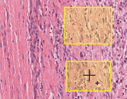
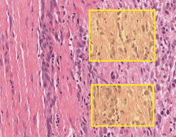
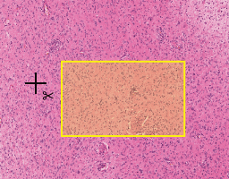
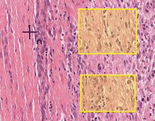
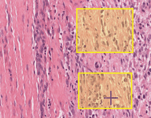

# Mouse and keyboard controls

This page lists the mouse, touch, and keyboard controls for the HistomicsUI
image viewer.

!!! info "Source and version"

    Adapted from HistomicsUI's
    [`docs/controls.rst`](https://github.com/DigitalSlideArchive/HistomicsUI/blob/master/docs/controls.rst)
    (Apache-2.0), last changed in commit
    [`2e9a298`](https://github.com/DigitalSlideArchive/HistomicsUI/commit/2e9a298f4e10)
    on 2025-12-03, and adapted on 2026-11-01.

    **Tested with:** HistomicsUI at that commit. This page was not re-executed
    against a live viewer in this documentation slice, so treat the source file
    as authoritative if a shortcut differs in your build.

## Basic image controls

### Pan

- **Left-drag**: Hold down the left mouse button and drag the image to change
  the area that is in view.
- **Middle-drag**: Hold down the middle mouse button and drag the image to
  change the area that is in view. This works even when editing annotations.
- **Single touch drag**.
- **Arrow keys**: Nudge the area in view by one screen pixel. Hold `shift` while
  pressing an arrow key to move by half a screen. `shift+ctrl` with an arrow key
  moves an intermediate amount.

### Zoom

- **Right-drag**: Hold down the right mouse button and drag up or down to change
  the zoom level.
- **Mouse wheel**.
- **Multi-touch spread or contract**.
- **`+`**, **`-`**: Zoom by 1/20th of a power of 2. With `shift`, zoom by a
  power of 2. With `shift+ctrl`, zoom by 1/4th of a power of 2.
- **`1`–`7`**: Zoom to discrete levels. `1` zooms all the way out, and each
  successive number zooms in further by a power of 8.
- **Shift-left-drag**, **shift-right-drag**: Zoom into or out of the selected
  rectangle.

### Rotate

- **Left-ctrl-drag**: Hold down `ctrl` and the left mouse button to rotate the
  image.
- **Ctrl-mouse wheel**.
- **Multi-touch rotate**.
- **`<`**, **`>`** (also `.` or `,`): Rotate the image a small amount. With
  `shift`, `<` and `>` rotate by 90 degrees.
- **`0`**: Return the image to the default orientation.

## Overview image controls

### Pan

- **Left-drag**: Drag anywhere inside the view rectangle to change the area that
  is in view.
- **Left-click**: Click anywhere in the overview window to recenter the main
  image around that point.

### Zoom

- **Shift-left-drag**: Draw a rectangle on the overview and the selected area
  is shown in the main image. If `shift` is held throughout, the selection is
  constrained to a square. If `shift` is released after starting, the selection
  can be any rectangle.

## Annotation controls

### Show or hide all annotations

- **`a`**: If any annotations are hidden, show all annotations. If all
  annotations are shown, hide all annotations.

### Select annotations

- **Right-click**: Right-clicking an annotation element opens a context menu to
  change its style group, edit its shape or properties, or delete it. If more
  than one element is selected, the menu applies to all selected elements.
- **`m`**: Show the context menu for the selected annotations. If nothing is
  selected, show the context menu for the annotation under the mouse cursor.
- **`s`**: Switch to area-select mode. Left-drag a rectangle around elements to
  select them.
- **`S`**: Switch to area-select polygon mode. Draw a polygon around elements to
  select them.
- **`C`**: Clear the current selection.
- **Ctrl-left-click**: Toggle whether an individual annotation element is
  selected.

### Create an annotation

- **`space`**: Show the new annotation dialog. This is the same as clicking the
  **New** button.

### Draw an annotation element

- **`o`**, **`r`**, **`i`**, **`c`**, **`p`**, **`l`**, **`b`**: Switch to
  point, rectangle, ellipse, circle, polygon, line, or brush drawing mode. If
  already in that mode, turn it off.
    - **`shift`**: While drawing a rectangle or ellipse, hold `shift` after
      starting to adjust it to a square or circle.
- **`enter`**: While drawing a line or polygon, finish drawing, closing the
  polygon or terminating the line.
- **`esc`**: Cancel drawing an annotation element.

### Edit or modify an annotation shape

- **`e`**: With the mouse over an annotation element, put it in edit mode. This
  is the same as choosing **Edit Shape** from the context menu.
- **`shift`**: While drawing an element with area (everything except points and
  lines), switch to **Add** mode. Hold `shift` when the annotation is started
  (the first point in a polygon, rectangle, and so on). When finished, the
  element is combined with existing elements in the same annotation document
  and style group.

    { width="256" }

- **`ctrl`**: While drawing an element with area, switch to **Subtract** mode.
  The drawn annotation is removed from existing elements in the same annotation
  document and style group.

    { width="256" }

- **`ctrl`**: While drawing a line annotation, switch to **Cut** mode. The line
  splits any area annotations with the same style group.

    { width="256" }

- **`ctrl+alt`**: While drawing an annotation with area, switch to **Cut** mode.
  The drawn annotation splits any area annotations with the same style group.

- **`shift+ctrl`**: While drawing an element with area, switch to **Union**
  mode. The drawn annotation is combined with nearby existing elements in the
  same annotation document and style group, keeping only area that is in both
  the new and existing elements.

    { width="256" }

- **`shift+alt`**: While drawing an element with area, switch to **XOR** mode.
  The drawn annotation is combined with nearby existing elements in the same
  annotation document and style group, keeping area that is in either but not
  both, and removing area that is in both.

    { width="256" }

### Brush controls

The brush drawing tool always combines with existing annotation elements in the
current annotation and style.

- **`B`**: Cycle through the brush shapes (square and circle).
- **`[`**, **`]`**: Change the size of the brush.

### Change the style group

- **`q`**, **`w`**: Cycle through the available style groups for the current
  selection.

### Pixelmap controls

- **Left-click** a superpixel to change its category to the current style
  group.
- **Shift-left-drag** to change multiple superpixels as the mouse passes over
  them.

## Frame selector controls

### Channel and band controls

When compositing channels or bands, you can toggle the visibility of individual
channels or bands.

- **`ctrl+<number>`**: Toggle the visibility of channels or bands 1 through 10.
- **`alt+ctrl+<number>`**: Toggle the visibility of channels or bands 11
  through 20.
